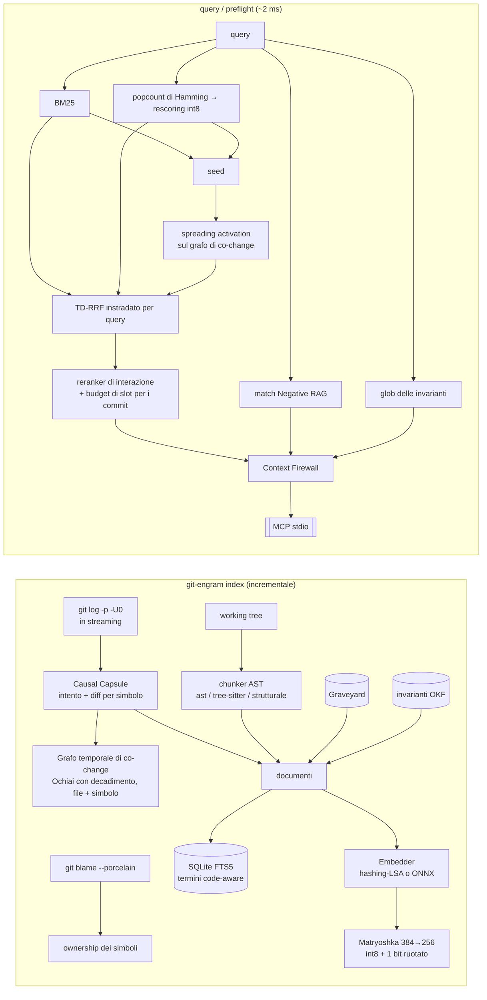
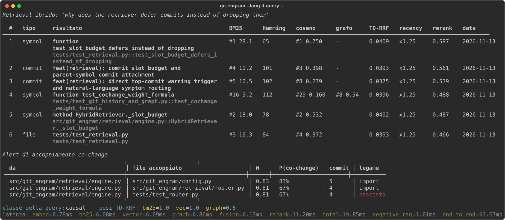
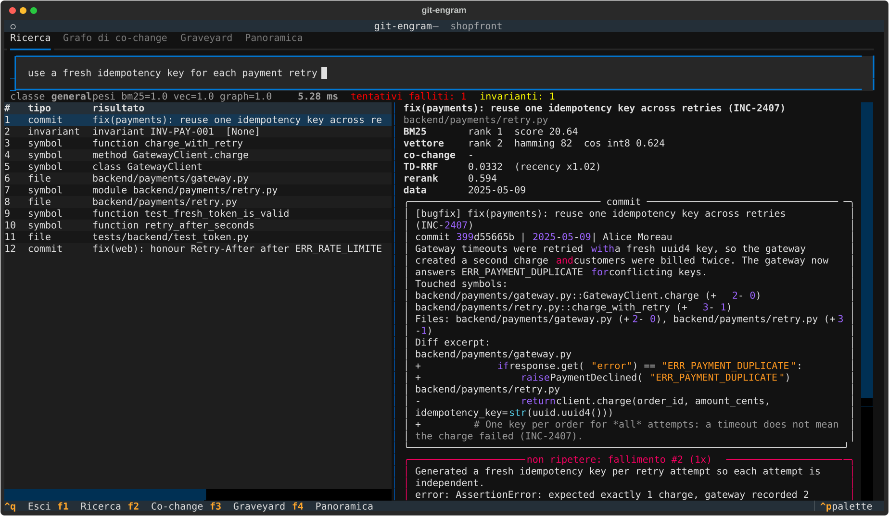
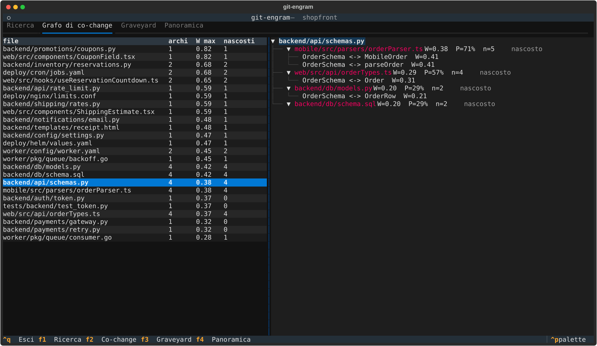
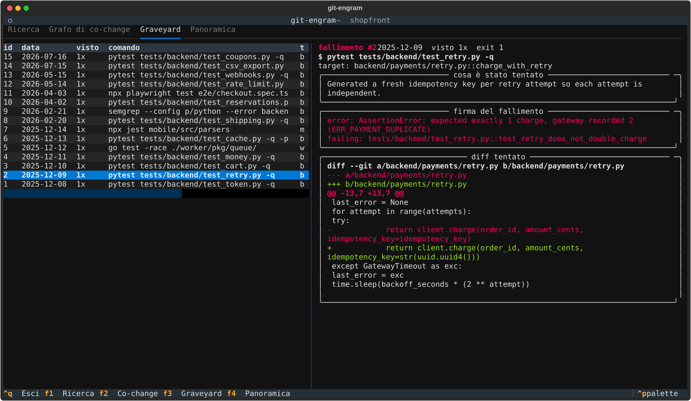

<div align="center">

# git-engram

[English](README.md) · **Italiano**

<a href="https://paypal.me/giuseppegambino92"></a>

**Il tuo coding agent dimentica *perché* il codice è fatto così. git-engram se lo ricorda.**

Un motore di memoria local-first di **Spatio-Temporal, Causal & Negative RAG** per AI coding agent,<br>
servito tramite il **Model Context Protocol** in ~2 ms. Niente LangChain, niente LlamaIndex, niente GPU, niente rete.


</div>

---

**Indice:** [Il problema](#il-problema-amnesia-causale) · [Cosa vede l'agent](#cosa-vede-lagent) ·
[Benchmark](#benchmark) · [Architettura](#architettura) · [Guida rapida](#guida-rapida) · [Strumenti MCP](#strumenti-mcp) ·
[CLI](#cli) · [Dashboard](#dashboard-interattiva) · [API Python](#api-python) ·
[Dati e privacy](#cosa-viene-salvato-e-cosa-resta-in-locale) · [Configurazione](#configurazione) ·
[Dogfooding](#dogfooding-git-engram-applicato-a-se-stesso) · [Sviluppo](#sviluppo) · [Limitazioni](#limitazioni) ·
[Roadmap](#roadmap)

## Il problema: amnesia causale

Il RAG sul codice indicizza ciò che il codice **è**. Gli agent rompono le cose a causa di ciò che il codice **era**:

1. **Eliminano codice portante.** Quello strano `- CLOCK_SKEW_SECONDS` sembra ridondante, ma otto mesi fa ha risolto
   un incidente in produzione. La spiegazione sta in un messaggio di commit che nessuno va a recuperare.
2. **Ripetono tentativi già falliti.** La sessione di ieri ha provato a generare una nuova chiave di idempotenza a ogni
   retry, ha rotto i test e ha lanciato `git checkout .`. Il diff e lo stack trace sono spariti, quindi la sessione di
   oggi ci riprova.
3. **Non vedono gli accoppiamenti nascosti.** `backend/api/schemas.py` e `mobile/src/parsers/orderParser.ts` non sono
   collegati da alcun import, eppure sono cambiati insieme in 5 commit su 7. L'analisi statica non può vedere questo
   legame. La storia git sì.

`git-engram` indicizza **simboli AST × causalità git × co-change temporale × tentativi falliti** e serve il risultato
a Claude Code, Cursor, OpenCode o Windsurf come un unico blocco di contesto compatto e sanificato.

## Cosa vede l'agent

Output reale di `engram_preflight_check("backend/payments/retry.py", "charge_with_retry", "generate a fresh
idempotency key for every retry attempt")` sul repository di benchmark (abbreviato):

```xml
<engram_preflight file="backend/payments/retry.py" symbol="charge_with_retry" latency_ms="12.55">
<invariants must_hold>
  <invariant id="INV-PAY-001" severity="critical" scope="backend/payments/**">Every gateway charge must reuse ONE
  idempotency key per order across all retries; never create keys inside the retry loop (INC-2407).</invariant>
</invariants>
<anti_context_do_not_repeat>
These approaches were ALREADY TRIED in this repository and FAILED. Do not repeat them; ...
  <failed_attempt id="2" date="2025-12-09" occurrences="1" exit_code="1">
    targets: backend/payments/retry.py::charge_with_retry
    command: pytest tests/backend/test_retry.py -q
    what was tried: Generated a fresh idempotency key per retry attempt so each attempt is independent.
    failure signature:
      error: AssertionError: expected exactly 1 charge, gateway recorded 2 (ERR_PAYMENT_DUPLICATE)
      failing: tests/backend/test_retry.py::test_retry_does_not_double_charge
    attempted diff (excerpt):
      -            return client.charge(order_id, amount_cents, idempotency_key=idempotency_key)
      +            return client.charge(order_id, amount_cents, idempotency_key=str(uuid.uuid4()))
    matched because: same symbol backend/payments/retry.py::charge_with_retry; error-signature term overlap 100%
  </failed_attempt>
</anti_context_do_not_repeat>
<load_bearing_code why_this_code_exists>
  ! 3 line(s) of charge_with_retry (23%) were written by 399d55665b [bugfix] "fix(payments): reuse one idempotency
    key across retries (INC-2407)" -- removing them may re-open that bugfix.
</load_bearing_code>
<causal_history>
  2025-05-09 399d55665b [bugfix] fix(payments): reuse one idempotency key across retries (INC-2407) (+3 -1)
      +     idempotency_key = f"{order_id}:{uuid.uuid5(uuid.NAMESPACE_URL, order_id)}"
      -             return client.charge(order_id, amount_cents, idempotency_key=str(uuid.uuid4()))
</causal_history>
<co_change_coupling>
  backend/payments/gateway.py  W=0.49  P(changes|target changes)=100%  co-commits=2  [import-linked]
</co_change_coupling>
</engram_preflight>
```

Ora l'agent conosce la regola, il motivo per cui esiste, la patch esatta che è già fallita e cos'altro deve cambiare.
(12.55 ms si riferiscono a un processo CLI one-shot a freddo; dentro il server MCP long-running la stessa chiamata
richiede 1.4–2.3 ms.)

---

## Benchmark

`git-engram benchmark` costruisce un monorepo sintetico riproducibile (API Python, web + mobile in TypeScript, worker
Go, YAML/SQL/HTML/nginx) con 65 commit datati. Contiene bugfix realistici, una "ottimizzazione" di performance poi
revertita, accoppiamenti nascosti tra linguaggi diversi, un file vendored avvelenato e 15 tentativi falliti di agent
nel Graveyard.

Ogni configurazione vede **lo stesso corpus, lo stesso embedder e lo stesso indice FTS5**. Le baseline ricevono i
record dei fallimenti come documenti ordinari. Per le loro metriche di ranking i fallimenti vengono filtrati (il
trattamento più generoso); il loro warning hit-rate conta un fallimento rilevante in qualunque posizione del top-5 non
filtrato.

### Protocollo di valutazione

Le query sono suddivise in sei split ([`dataset.py`](src/git_engram/evals/dataset.py)). Ogni split held-out è stato
committato prima della modifica che valuta; `git merge-base --is-ancestor` verifica ciascuna coppia:

| split | query | stato | committato in |
|---|---:|---|---|
| dev / calibrazione | 48 | ogni peso, soglia e scelta progettuale è stato deciso guardando queste query (comportamentali `6f9e13e`, bug report in linguaggio naturale `7e41bc1`) | `54dc0c0` |
| held-out v1 | 24 | ritirato: usato per diagnosticare l'affollamento dei commit | `d049d5e`, prima del router `1a7d202` |
| held-out v2 | 24 | ritirato: usato per diagnosticare i falsi allarmi | `cc98b38`, prima del budget di slot `20cdcec` |
| held-out v3 | 24 | ritirato: usato per diagnosticare la regressione causale e i falsi allarmi sulle funzioni sorelle | `df0f18b`, prima dell'ancoraggio ai simboli `3ab2409` |
| held-out v4 | 30 | ritirato: usato per diagnosticare la recall degli avvisi e il routing delle regressioni | `91ea29f`, prima del routing code-first e del gating `a4f0cba` |
| held-out **v5** | 30 | **principale**: estensione promozioni / export CSV, bug report in linguaggio naturale, probe sulle funzioni sorelle | `f6a6f0f`, prima del trigger sul top commit e del routing dei sintomi `8465b92` |

Durante il round v4, una query v4 è stata eseguita una volta in uno unit test prima della valutazione finale (le
impostazioni erano già congelate). Un test di guardia (`test_no_test_file_contains_held_out_query_text`) ora copre ogni
split held-out, e in questo round nessuna query held-out è stata eseguita prima della propria valutazione.

### Held-out v5: 30 query mai viste (risultato principale)

| Configurazione | Recall@3 | Recall@5 | MRR | nDCG@5 | Hit avvisi negativi | Falsi allarmi | Scoperta co-change | RAM indice (KB) | P50 (ms) | P95 (ms) |
|---|---:|---:|---:|---:|---:|---:|---:|---:|---:|---:|
| Dense RAG (coseno float32) | 0.778 | 0.817 | 0.850 | 0.771 | **100%** | 12% | 67% | 360.0 | 0.16 | 0.23 |
| Solo BM25 (SQLite FTS5) | 0.756 | 0.817 | 0.874 | 0.803 | 83% | **0%** | 67% | **74.0** | 0.30 | 0.40 |
| Ibrido (BM25 + float32, RRF) | 0.761 | 0.833 | 0.899 | 0.826 | 83% | 4% | 67% | 434.0 | 0.38 | 0.56 |
| **git-engram** (completo) | **0.800** | **0.872** | **0.967** | **0.902** | **100%** | 8% | **83%** | 149.4 | 1.60 | 2.18 |

| nDCG@5, held-out v5 | "perché" causale | "perché" comportamentale | bug report in linguaggio naturale | file accoppiati | codici di errore |
|---|---:|---:|---:|---:|---:|
| Dense RAG (float32) | 0.754 | **1.000** | 0.764 | 0.564 | 0.774 |
| Solo BM25 | 0.902 | 0.929 | 0.828 | 0.468 | **0.889** |
| Ibrido (BM25 + float32) | 0.922 | 0.994 | 0.802 | 0.526 | 0.886 |
| **git-engram** | **0.942** | 0.991 | **0.878** | **0.824** | 0.874 |

**Split ritirati, engine attuale** (nDCG@5 vs BM25 · warning hit rate · falsi allarmi): v4 **0.832** vs 0.753 · 100% ·
14%; v3 **0.842** vs 0.751 · 86% · 24%; v2 **0.872** vs 0.784 · 100% · 6%; v1 **0.830** vs 0.757 · 80% · 5%.
**Dev** (ottimistico): **0.818** vs 0.735, warning hit rate 90%, falsi allarmi 7%. Tabelle complete:
[`benchmarks/RESULTS.md`](benchmarks/RESULTS.md).

**Ablation:** ogni riga modifica un solo componente, misurato su dev e su held-out v5.

| Variante | nDCG@5 dev | nDCG@5 **v5** | Recall@5 v5 | MRR v5 | Co-change v5 | Hit neg. v5 | Falsi allarmi v5 |
|---|---:|---:|---:|---:|---:|---:|---:|
| git-engram (completo) | 0.818 | 0.902 | 0.872 | 0.967 | 83% | 100% | 8% |
| − trigger diretto di avviso dal top commit | 0.818 | 0.902 | 0.872 | 0.967 | 83% | 67% | 8% |
| − routing ampio dei sintomi (vecchie regole) | 0.812 | 0.893 | 0.872 | 0.950 | 83% | 83% | 8% |
| espansione co-change sui sintomi attiva (grafo 0.3) | 0.816 | 0.902 | 0.872 | 0.967 | 83% | 100% | 8% |
| − gate di rilevanza dei commit (qualsiasi commit nel top 3) | 0.818 | 0.902 | 0.872 | 0.967 | 83% | 100% | 42% |
| ancoraggio del graveyard a livello di file (legacy) | 0.818 | 0.902 | 0.872 | 0.967 | 83% | 100% | 50% |
| − route comportamentale code-first | 0.820 | 0.855 | 0.872 | 0.900 | 83% | 100% | 4% |
| − pinning dei simboli nominati | 0.812 | 0.902 | 0.872 | 0.967 | 83% | 100% | 8% |
| − budget di slot per i commit | 0.802 | 0.900 | 0.872 | 0.967 | 83% | 100% | 8% |
| − router adattivo alla query | 0.765 | 0.826 | 0.889 | 0.867 | 83% | 83% | 8% |
| − profilo di rerank per identificatori esatti | 0.818 | 0.896 | 0.872 | 0.967 | 83% | 100% | 12% |
| + diversità di file MMR (opt-in) | 0.818 | 0.886 | 0.844 | 0.967 | 83% | 100% | 8% |
| − percorso del grafo di co-change | 0.794 | 0.894 | 0.861 | 0.961 | 67% | 100% | 8% |
| − reranker di interazione | 0.606 | 0.855 | 0.894 | 0.906 | 83% | 83% | 4% |
| − decadimento temporale (RRF semplice) | 0.821 | 0.889 | 0.861 | 0.967 | 67% | 100% | 4% |
| float32 esatto al posto di 1 bit + int8 | 0.818 | 0.902 | 0.872 | 0.967 | 83% | 100% | 8% |

**Latenza di `engram_preflight_check`:** P50 **1.11 ms**, P95 **1.83 ms** (server MCP a caldo, 7 target × 30 esecuzioni).

**Ricerca quantizzata a due stadi su larga scala** (miscele sintetiche di topic di Dirichlet derivate dagli embedding
del corpus, 400 candidati):

| Vettori | Recall@10 vs float32-384d | Recall@10 vs float32-256d | P50 a due stadi | P50 float32 | RAM a due stadi | RAM float32 |
|---:|---:|---:|---:|---:|---:|---:|
| 10,000 | 0.874 | 0.990 | 0.18 ms | 0.23 ms | 2.8 MB | 14.6 MB |
| 100,000 | 0.733 | 0.970 | **0.62 ms** | 2.44 ms | **27.8 MB** | 146.5 MB |

**Context firewall:** 12/12 payload di injection rilevati e neutralizzati; 0/12 snippet benigni modificati.

Apple M-series, Python 3.14, single thread. Le latenze variano fino a ~2× tra un'esecuzione e l'altra sulla stessa
macchina a seconda del carico; le metriche di qualità sono deterministiche. Numeri grezzi:
[`benchmarks/RESULTS.md`](benchmarks/RESULTS.md), [`benchmarks/results.json`](benchmarks/results.json). Per
riprodurli: `git-engram benchmark`.

### Leggere i numeri con onestà

- **Entrambi gli obiettivi di v4 sono stati raggiunti su dati mai visti.** La warning recall è al **100%** su v5 (67%
  senza il trigger diretto sul top commit) e al 100% sul v4 ritirato (prima era al 62%). I bug report in linguaggio
  naturale ottengono **0.878 vs 0.828** di BM25; sul v4 ritirato il risultato è 0.824 vs 0.764, cioè il divario che il
  round precedente aveva lasciato aperto. Il routing ampio dei sintomi ha indirizzato tutti e 6 i bug report di v5
  alla route `symptom`.
- **Falsi allarmi: 8% su v5**, sotto l'obiettivo di ~14% e sotto dense (12%), ma sopra BM25 (0%) e l'ibrido (4%). Il
  trigger ha un costo sullo split costruito apposta per sondare i falsi allarmi sulle funzioni sorelle: il v3 ritirato
  è salito dal 18% al **24%** (BM25 12%). Il commit di *fix* di una funzione sorella che si classifica #1 ora
  attribuisce credito direttamente alle sue funzioni. Il gate congiuntivo continua a fare gran parte del lavoro: senza
  di esso i falsi allarmi su v5 salgono al 42%.
- **Cosa non ha fatto differenza.** Smorzare l'espansione co-change sulle route dei sintomi è neutro sia su dev sia su
  v5; il guadagno sulle regressioni è arrivato dal routing più la possibilità di avere due commit nel top 5. Il
  pinning è risultato neutro su v5.
- **Dove git-engram non è in testa.** Query su identificatori esatti (0.874 vs 0.889 di BM25), query comportamentali
  (dense arriva a 1.000 vs 0.991) e falsi allarmi rispetto a BM25. Inoltre v5 è più facile degli split precedenti per
  ogni configurazione: tutte le baseline ottengono punteggi più alti qui che su dev o v4, quindi i suoi numeri
  assoluti favoriscono tutti, non solo git-engram.
- **Qui la quantizzazione non costa nulla.** Su ogni split la ricerca a due stadi 1-bit → int8 produce metriche
  *identiche* a quelle del float32 esatto. A 100k vettori conserva il 97% del top-10 float32 di pari dimensione con
  5.3× meno RAM ed è ~4× più veloce.
- **Ancora sintetico.** Un solo repository generato e 180 query. Considera i numeri come evidenza a favore dei
  meccanismi, non come una classifica universale.

---

## Architettura



```
src/git_engram/
├── indexer/      ast_chunker · gitio (log/cat-file/blame plumbing) · history (capsules) · cochange · pipeline
├── embeddings/   hashing-LSA (offline) · ONNX backend · quantization (MRL/int8/1-bit) · two-stage vector index
├── retrieval/    lexical (FTS5 BM25) · graph (spreading activation) · fusion (TD-RRF) · reranker · engine
├── graveyard/    failure store · signature extraction · `exec` watcher
├── security/     context firewall (invisible Unicode, injection rules, perplexity LM)
├── invariants.py OKF invariants        engine.py  facade        render.py  agent-facing context blocks
├── mcp/server.py MCP stdio server      cli/main.py  Rich CLI    evals/  fixture · dataset · metrics · runner
```

### 1. Indicizzazione AST spazio-temporale

Ogni file viene suddiviso in **simboli**: funzioni, classi, metodi, tipi, più un resto `<module>` per costanti e
import. Per Python si usa l'`ast` di CPython. Gli altri linguaggi usano tree-sitter quando una grammatica è presente
nella cache locale, altrimenti un parser strutturale consapevole del lexer (pattern di dichiarazione più un matcher di
parentesi graffe che salta stringhe, commenti e liste di parametri). Un test verifica che entrambi i backend producano
nomi di simboli identici sulla fixture.

La storia viene attribuita **per simbolo, non per file**. Ogni file toccato viene ri-parsato *a quel commit* e *al suo
parent* (`git cat-file --batch`), e ogni hunk `-U0` viene risolto nel simbolo contenitore più specifico. Si ottiene così
una traccia in stile `git log -L` per ogni funzione in un'unica passata in streaming, seguendo anche i rename.
`git blame` aggiunge l'ownership delle righe, così il preflight può dire *"il 23% di questa funzione è stato scritto
da un commit di bugfix"*.

Ogni commit diventa una **Causal Capsule** deterministica: intento (`bugfix | security | revert | perf | feature |
refactor | …`), messaggio, simboli toccati con i conteggi `+/−` e un estratto del diff. Queste capsule sono documenti
che affiancano il codice, quindi le domande sul "perché" recuperano il commit che vi risponde.

### 2. Retrieval a due stadi con Hamming a 1 bit e int8 Matryoshka

I vettori sono memorizzati in tre forme in BLOB SQLite e caricati in array NumPy contigui:

| livello | contenuto | byte (384→256d) |
|---|---|---:|
| `bin` | bit di segno di $R\,\hat v_{1:256}$ ($R$ ortogonale casuale), impacchettati, bit-sliced | 32 |
| `i8` | int8 simmetrico per vettore di $\hat v_{1:256}$ | 256 |
| `f32` | vettore completo, solo su disco (baseline / ri-quantizzazione) | 1536 |

**Troncamento Matryoshka.** $\hat v_{1:d} = v_{1:d} / \lVert v_{1:d} \rVert$. L'embedder offline predefinito
(feature hashing → TF-IDF → SVD troncata randomizzata) ordina le componenti per valore singolare. Per il teorema di
Eckart–Young, ogni prefisso è quindi la migliore approssimazione di rango $d$, che è esattamente la proprietà che i
modelli neurali addestrati con MRL imparano.

**Stadio 1: Hamming.** I bit di segno grezzi funzionano male con embedding spettralmente concentrati: un documento
con rank esatto 5 finiva al rank 112 in Hamming. git-engram applica prima una rotazione fissa Haar-random (SimHash).
La probabilità di bit-flip diventa allora proporzionale all'angolo,

$$\Pr\big[\mathrm{sgn}(r_j^\top x)\neq \mathrm{sgn}(r_j^\top y)\big] = \frac{\theta(x,y)}{\pi},$$

quindi $\mathbb{E}[d_H]/d = \theta/\pi$. Questa proprietà è verificata in `tests/test_quantization.py` e ha portato la
recall@10 dello stadio 1 da 0.49 a 0.91. Le distanze vengono calcolate come `popcount(XOR)` su un layout
**bit-sliced, column-major** (una lane `uint64` contigua per ogni gruppo di 64 bit, su tutti i vettori). È 13× più
veloce della forma row-major in NumPy. La selezione top-C è una counting select O(n) sull'istogramma delle distanze
0…256.

**Stadio 2: rescoring int8 asimmetrico** dei C candidati con la query float32:
$\cos(q, \tilde d) = \frac{q^\top \tilde d}{\lVert q\rVert\,\lVert \tilde d\rVert}$, dove la scala per vettore si semplifica.

### 3. Grafo temporale di co-change

Per i nodi $A,B$ (file *e* simboli) con insiemi di commit $C_A, C_B$:

$$W(A,B) \;=\; \frac{\displaystyle\sum_{c\,\in\, C_A \cap C_B} e^{-\lambda\,(t_{\text{now}} - t_c)}}{\sqrt{|C_A|\cdot|C_B|}}, \qquad \lambda = \frac{\ln 2}{t_{1/2}}$$

Si tratta di un coefficiente di Ochiai/coseno con decadimento temporale. git-engram memorizza anche la confidenza
direzionale $P(B\mid A) = |C_A\cap C_B|/|C_A|$. I commit massivi (più di 40 file) vengono scartati, gli archi
richiedono almeno 2 co-commit e ogni arco viene etichettato come **hidden** quando nessuno dei due file importa l'altro.
`t_now` è il commit indicizzato più recente, quindi i risultati sono riproducibili e un repo poco attivo non viene
penalizzato.

### 4. Retrieval a tre percorsi con RRF a decadimento temporale

Il percorso 1 (FTS5 BM25) e il percorso 2 (vettori a due stadi) vengono eseguiti in parallelo. La loro fusione
preliminare fornisce i seed al **percorso 3**, una spreading activation a un hop che fa emergere file *al di fuori*
dei risultati migliori correnti. I vicini collegati da import vengono penalizzati, perché l'analisi statica li trova
già:

$$a(v) = \delta \sum_{s \in \text{seeds}} a(s)\, W(s,v)\,\gamma^{\,\mathbf{1}[\text{import-linked}(s,v)]}$$

I tre ranking vengono fusi con la **Time-Decayed Reciprocal Rank Fusion**:

$$\mathrm{Score}(d) = \sum_{m \in \{\text{BM25},\,\text{Vec},\,\text{Graph}\}} \frac{w_m}{k + \mathrm{rank}_m(d)} \cdot \left(1 + \alpha\, e^{-\lambda \Delta t_d}\right)$$

Qui $\Delta t_d$ è l'età dell'ultima modifica del documento: l'ultimo commit che ha toccato quel simbolo, il commit
stesso oppure il momento del fallimento. Valori di default: $k=60$, $w_m=1$, $\alpha=0.25$, $t_{1/2}=120$ giorni.

I primi 30 risultati vengono poi **riordinati** da un cross-scorer pluggable. Quello predefinito è un modello di
interazione deterministico sulla coppia (query, documento): copertura dei termini pesata per IDF, match sui campi,
prossimità dei bigrammi, hit letterali di identificatori/codici di errore, coseno int8, concordanza tra intento della
query e tipo di documento, e attivazione del grafo. Un cross-encoder ONNX può sostituirlo
(`retrieval.cross_encoder_dir`). La **diversità di file MMR**, che penalizza la presenza di più documenti provenienti
dallo stesso file, è disponibile come opt-in (`retrieval.mmr`). È disattivata di default perché ha abbassato l'nDCG@5
held-out su due split consecutivi mai visti.

### 4b. Router adattivo alla query

Prima della fusione, un classificatore deterministico esamina le caratteristiche superficiali della query e sceglie,
per ogni query, i pesi dei percorsi e l'intento del reranker ([`router.py`](src/git_engram/retrieval/router.py)). Vale
la regola della precedenza: vince il primo match.

| classe | trigger | $w_{\text{BM25}}$ | $w_{\text{vec}}$ | $w_{\text{graph}}$ | il reranker privilegia |
|---|---|---:|---:|---:|---|
| `behavioral` | "why does/is `<named function>` …" senza indizi sulla storia | 1.2 | 1.0 | 0.3 | neutro; il simbolo nominato viene **fissato al rank 1** |
| `causal` | why / reason / purpose / rationale / explain (incl. was/did/changed/reverted) | 1.0 | 1.0 | 0.5 | commit, fallimenti |
| `change` | imperativi add / change / rename / tune / raise ... | 1.0 | 1.0 | **1.3** | codice |
| `exact` | hash di commit, `ERR_X` / `E4012` / `INC-123`, nome di eccezione, stringa tra virgolette, percorso di file | **2.0** | 0.4 | 0.2 | hit letterali sui token |
| `symptom` | bug report in linguaggio naturale: "billed twice", perdite silenziose, stato obsoleto, "kept / stopped / ended up", narrazioni al passato | 1.2 | 1.0 | **0** (espansione disattivata) | commit che hanno risolto il problema (2 slot) |
| `general` | tutto il resto | 1.0 | 1.0 | 1.0 | auto |

Il routing costa microsecondi e non guarda mai il corpus. I pesi sono stati fissati una sola volta, a partire dal
ragionamento esposto sopra, e verificati soltanto sullo split dev. La classe e i pesi utilizzati vengono restituiti con
ogni ricerca (`query_class`, `fusion_weights`) e mostrati da `git-engram query` e dalla TUI.

### 4c. Budget di slot per i commit e aggancio al simbolo padre

Le commit capsule sono spesso il miglior match lessicale *e* semantico per una domanda, quindi un ranker senza vincoli
può occuparne 3–4 dei primi 5 posti e spingere il codice che l'agent deve modificare al rank 6+. L'assemblaggio finale
del top-k è quindi **stratificato**: al massimo $c_{\text{class}}$ commit capsule possono occupare i primi 5 slot, dove

$$c_{\text{causal}} = 3,\quad c_{\text{behavioral}} = c_{\text{symptom}} = c_{\text{exact}} = c_{\text{general}} = 2,\quad c_{\text{change}} = 0 .$$

I commit in eccesso vengono **posticipati** al rank 6+, mai scartati. Per conservare il contesto causale che quegli
slot portavano, ogni hit di codice riceve dei **commit agganciati**: i commit che hanno modificato esattamente quel
simbolo, privilegiando quelli che erano candidati del retrieval e portanti (`bugfix`/`security`/`revert`). Vengono
mostrati come righe `why:` sotto il risultato. I limiti sono stati scelti soltanto sullo split dev, e la metrica del
benchmark **non** attribuisce alcun credito agli agganci.

**Pinning dei simboli nominati.** Per le query `behavioral`, `exact` e `change`, un simbolo che la query nomina
esattamente (un nome qualificato come `TTLCache.set` o un identificatore distintivo come `sign_webhook`; le parole
generiche non fanno mai match) ha il rank 1 garantito, anche se il ranker non l'ha trovato. Su held-out v4, rimuovere la
route comportamentale costa −0.061 di nDCG@5 e rimuovere il pinning −0.019.

### 5. Negative RAG: il Graveyard Index

`git-engram exec -- pytest -x` è un wrapper trasparente: l'output viene mostrato in tempo reale tramite tee e l'exit
code viene preservato. In caso di exit code diverso da zero, salva uno snapshot di `git diff HEAD` più i piccoli file
non tracciati ed estrae una **firma del fallimento** (pytest, traceback Python, Go `--- FAIL`/`DATA RACE`, Rust
`error[E…]`/panic, Jest, tsc). Mappa le righe modificate (non quelle di contesto) sui simboli AST che hanno toccato e
memorizza il tentativo. Le ripetizioni vengono deduplicate tramite un fingerprint che ignora indirizzi, durate, offset
degli hunk e whitespace, e il contatore delle occorrenze viene incrementato.

Al momento della query un fallimento viene mostrato quando

$$\underbrace{0.75\,[\text{same symbol}] \;\big|\; 0.5\,[\text{same file}] \;\big|\; 0.3\,[\text{targets a retrieved symbol}]}_{\text{structural}} \;+\; 0.6\cdot\max\!\big(\cos(q,f),\ \text{cov}_{\text{idf}}(q,f)\big) \;\ge\; 0.40$$

La soglia implica che un fallimento richiede o un forte match testuale da solo, oppure uno moderato *ancorato al codice
che si sta recuperando*. L'ancoraggio è **a livello di simbolo**: un fallimento il cui diff ha toccato una funzione nominata ottiene lo 0.3 solo quando
quella stessa funzione viene recuperata nel top 3. I commit recuperati aggiungono evidenza in due modi. Un commit
**portante** (bugfix / security / revert) che si classifica **#1**, o che ottiene un punteggio superiore a 0.65, è un
**trigger diretto**: ogni funzione che ha modificato ottiene 0.40, sufficiente a generare da solo un avviso, perché
quando la risposta migliore *è* il fix, un tentativo di rompere di nuovo quella funzione è rilevante. Ogni altro commit
passa attraverso il **gate di rilevanza dei commit**: almeno 0.9 × il miglior punteggio nel top 3, non essere un commit
massivo (più di 8 simboli), e la funzione del fallimento deve trovarsi *anche* tra i primi 5 hit di codice. I
fallimenti che non ricadono in alcun simbolo nominato ripiegano sul matching a livello di file. Nel preflight, una
funzione *diversa* del file target pesa solo 0.25. I match vengono mostrati in un blocco
`<anti_context_do_not_repeat>` con il diff fallito e il motivo.

### 6. Context firewall (difesa da CamoLeak / PoisonedRAG)

Tutto il testo che esce dall'engine viene scansionato:

- **L'Unicode invisibile viene rimosso**: "ASCII smuggling" tramite tag block (il payload nascosto viene decodificato e
  segnalato), caratteri zero-width, override bidi (Trojan Source), variation selector e altri code point `Cf`. Le
  sequenze emoji ZWJ legittime vengono mantenute.
- **Le injection vengono oscurate sul posto** dopo la normalizzazione NFKC, che neutralizza l'offuscamento con
  caratteri full-width: override delle istruzioni, finti delimitatori chat/tool, beacon tramite immagini markdown e
  proxy `camo` (il canale di esfiltrazione di CamoLeak), formulazioni volte a esfiltrare segreti, `curl | sh` e ordini
  distruttivi rivolti agli agent.
- **Gli span ad alta perplessità vengono segnalati.** Un LM a trigrammi di caratteri con hashing viene addestrato sul
  *tuo* repository e calibrato a 1.5 × il proprio 99.5° percentile di perplessità per finestra, così intercetta i
  suffissi in stile GCG senza farsi confondere dal dialetto della tua codebase. Si attiva solo quando il corpus è
  abbastanza grande da consentire la calibrazione.

### 7. Invarianti OKF

`.engram/invariants.okf.json` è conoscenza del team sotto version control: glob, eventualmente ristretti a simboli
(`backend/api/schemas.py::Order*`). Il matching è una regex precompilata. Non entrano in gioco né retrieval né scoring,
quindi un'invariante che fa match scatta *sempre*.

---

## Guida rapida

**Requisiti:** Python 3.11+ e `git` nel `PATH`. Le dipendenze runtime sono `numpy`, `pydantic`, `rich` e `mcp`;
niente GPU, nessun accesso alla rete e nessuna API key.

```bash
pipx install "git+https://github.com/giuseppegambino92/git-engram"   # or: uv tool install git+https://...
cd your-repo
git-engram index                   # AST + history + co-change graph + embeddings
git-engram preflight src/auth/token.py -s is_token_expired -i "remove the grace period"
```

Da un clone: `pipx install .` (oppure `uv tool install .`). Extra opzionali: `[tui]` per la dashboard, `[treesitter]`
per le grammatiche tree-sitter, `[onnx]` per embedding neurali e cross-encoder, ad esempio
`pipx install ".[tui,treesitter]"`. È prevista una release su PyPI.

### Claude Code

```bash
claude mcp add --scope project git-engram -- git-engram mcp
```

oppure committa un `.mcp.json` ([`examples/claude-code.mcp.json`](examples/claude-code.mcp.json)):

```json
{ "mcpServers": { "git-engram": { "command": "git-engram", "args": ["mcp"] } } }
```

### Cursor / Windsurf / OpenCode

`.cursor/mcp.json` ([`examples/cursor.mcp.json`](examples/cursor.mcp.json)):

```json
{ "mcpServers": { "git-engram": { "command": "git-engram", "args": ["-C", "${workspaceFolder}", "mcp"] } } }
```

Poi aggiungi lo snippet di [`examples/AGENTS.md`](examples/AGENTS.md) al tuo `CLAUDE.md` / `AGENTS.md` / `.cursorrules`,
così l'agent chiama il preflight prima di modificare il codice e lancia i test tramite `git-engram exec`.

### Strumenti MCP

| strumento | scopo |
|---|---|
| `engram_preflight_check(file_path, symbol_name?, intended_change_query?)` | contesto AST, perché il codice esiste, righe portanti, accoppiamento co-change, invarianti, anti-context |
| `engram_search_causal_history(query, top_k?, file_path?)` | ricerca ibrida a tre percorsi su codice, commit capsule, fallimenti e invarianti |
| `engram_record_failure(file_path, attempted_diff, error_trace, notes?, symbol_name?, command?)` | registra un approccio fallito nel Graveyard (indicizzato immediatamente) |
| `engram_record_invariant(rule_id, scope, invariant_description, severity?)` | memorizza un'invariante OKF deterministica |

Il server risponde subito all'handshake MCP e, al primo avvio, indicizza in background. Quando `HEAD` si sposta
re-indicizza in modo incrementale; il controllo è una `stat`/lettura di `.git/HEAD`, non un subprocess.

## CLI

```bash
git-engram index [path] [--rebuild]          # incremental by default (content hashes + last..HEAD)
git-engram query "why does X ..." [--file F] [--mode full|bm25|dense|hybrid] [--raw|--json]
git-engram preflight FILE [-s SYMBOL] [-i "intended change"] [--json]
git-engram exec [--notes "..."] -- pytest -x  # exit code preserved; failures go to the Graveyard
git-engram invariant add RULE --scope "src/payments/**" --description "..." --severity critical
git-engram graveyard                          # list failed attempts
git-engram inspect                            # hidden-coupling hotspots, load-bearing files, memory footprint
git-engram benchmark [--out RESULTS.md --json results.json]
git-engram tui ["optional query"]             # interactive dashboard (also: git-engram inspect --tui)
git-engram mcp                                # stdio MCP server
git-engram --lang it inspect                  # output in italiano; equivale a GIT_ENGRAM_LANG=it git-engram inspect
```

`git-engram query` stampa il dettaglio completo dello scoring per ogni hit: rank e score BM25, distanza di Hamming,
coseno int8, attivazione del grafo, score TD-RRF, moltiplicatore di recency, score di rerank e latenza per stadio.



*`git-engram --lang it query "why does the retriever defer commits instead of dropping them" --file
src/git_engram/retrieval/engine.py` sulla cronologia di questo stesso repository (vedi
[Dogfooding](#dogfooding-git-engram-applicato-a-se-stesso)).*

**Lingua.** Tabelle, pannelli, messaggi, testi di `--help` e dashboard sono disponibili in inglese (predefinito) e in
italiano. La lingua si sceglie con l'opzione globale `--lang en|it` (accettata prima o dopo il sottocomando) oppure con
la variabile d'ambiente `GIT_ENGRAM_LANG`; `--lang` ha la precedenza. L'output pensato per le macchine non viene mai
tradotto: `--json`, `--raw`, il blocco di contesto di `preflight`, il report del benchmark e tutte le risposte degli
strumenti MCP sono identici in ogni lingua, quindi gli agent ricevono sempre lo stesso payload. I dati del repository
(messaggi di commit, codice, firme dei fallimenti) sono mostrati così come sono salvati. I messaggi di errore propri di
argparse restano in inglese.

## Dashboard interattiva

`pip install 'git-engram[tui]'`, poi `git-engram tui` (in italiano: `git-engram tui --lang it`). Ha quattro tab, che
si selezionano con `F1`–`F4`:

- **Ricerca (Search):** ricerca as-you-type sull'intero engine, con l'evidenza di ciascun percorso per ogni hit
  (rank BM25, distanza di Hamming, coseno int8, attivazione co-change, TD-RRF, rerank). Mostra la classe del router, i
  pesi e la latenza end-to-end, più pannelli per anti-context, invarianti e alert di accoppiamento.
- **Grafo di co-change (Co-change graph):** gli hotspot di accoppiamento e, per il file selezionato, ogni vicino con W,
  P(co-change) e stato nascosto/legato da import, espandibile fino agli archi a livello di simbolo.
- **Graveyard:** ogni tentativo fallito con il relativo comando, la firma del fallimento e il diff con syntax
  highlighting.
- **Panoramica (Overview):** dimensione dell'indice, memoria quantizzata vs. float32, hotspot portanti e invarianti OKF.

| Ricerca live con anti-context | Grafo di co-change nascosto | Browser dei diff del Graveyard |
|---|---|---|
|  |  |  |

Gli screenshot sono render reali del repository di benchmark (`App.save_screenshot()`), rigenerati in inglese e in
italiano da `python scripts/make_screenshots.py` (vedi [Sviluppo](#sviluppo)). `tests/test_tui.py` pilota la stessa app
in modalità headless.

## API Python

Tutto ciò che fanno la CLI e il server MCP è disponibile tramite la facade `Engram`:

```python
from git_engram.engine import Engram
from git_engram.render import render_preflight

with Engram("path/to/repo") as engram:
    engram.index()                                   # incremental after the first run

    resp = engram.search("why does the cache take a lock on reads", top_k=5)
    print(resp.query_class, resp.fusion_weights)     # router decision, here "causal"
    for hit in resp.hits:
        print(hit.kind, hit.title, hit.bm25_rank, hit.vec_rank, hit.graph_rank, round(hit.score, 3))
    for warning in resp.warnings:                    # Negative RAG: failed attempts not to repeat
        print(warning.failure_id, warning.match_reason)

    report = engram.preflight("src/payments/retry.py", "charge_with_retry", "new key per retry")
    print(render_preflight(report))                  # the exact block an MCP client receives

    engram.record_failure(file_path="src/payments/retry.py", attempted_diff=diff_text,
                          error_trace=pytest_output, notes="tried a fresh key per retry")
    engram.record_invariant("PAY-1", "src/payments/**", "One idempotency key per order", "critical")
```

I risultati sono modelli pydantic tipizzati (`SearchResponse`, `Hit`, `FailureWarning`, `PreflightReport`), quindi
`.model_dump_json()` restituisce una struttura JSON stabile.

## Cosa viene salvato e cosa resta in locale

git-engram è local-first: non apre mai connessioni di rete, non invia telemetria e non richiede API key. Tutto risiede
in `.engram/` nella root del repository:

| percorso | contenuto | da committare? |
|---|---|---|
| `.engram/engram.db` | SQLite (WAL): simboli, commit capsule, grafo di co-change, indice FTS5, vettori quantizzati, graveyard, stato dell'embedder | no (viene ricostruito a partire da git; un `.engram/.gitignore` viene creato automaticamente) |
| `.engram/invariants.okf.json` | invarianti OKF registrate tramite CLI/MCP | **sì**: è conoscenza condivisa del team |
| `.engram/config.json` | override opzionali della configurazione | a tua scelta |

Il Graveyard memorizza i diff e l'output di errore dei tentativi falliti. Questi dati restano nel database locale e
vengono restituiti soltanto attraverso il context firewall. Elimina `.engram/engram.db` per dimenticare tutto tranne le
invarianti.

## Dogfooding: git-engram applicato a se stesso

Questo repository è costruito con commit atomici (`git log --oneline`), quindi git-engram può indicizzare la propria
storia:

```console
$ git-engram index .
  files 72 · AST symbols 743 · commits 41 · documents 671 · co-change edges file/symbol 96/349
$ git-engram preflight src/git_engram/retrieval/engine.py -s HybridRetriever._slot_budget \
      -i "drop the commit cap from top-k assembly"
<ast_context>
  method HybridRetriever._slot_budget  src/git_engram/retrieval/engine.py:L342-L360
  blame ownership: 20cdcece [feature] 100%
</ast_context>
<causal_history>
  2026-11-13 20cdcece6e [feature] feat(retrieval): commit slot budget and parent-symbol commit attachment (+19 -0)
</causal_history>
<co_change_coupling>
  src/git_engram/config.py  W=0.83  P(changes|target changes)=83%  co-commits=5  [import-linked]
  src/git_engram/retrieval/router.py  W=0.82  P(changes|target changes)=67%  co-commits=4  [import-linked]
  tests/test_router.py  W=0.82  P(changes|target changes)=67%  co-commits=4  [hidden: no import link]
  tests/test_retrieval.py  W=0.73  P(changes|target changes)=67%  co-commits=4  [import-linked]
  src/git_engram/engine.py  W=0.73  P(changes|target changes)=67%  co-commits=4  [import-linked]
</co_change_coupling>
<related_memory>
  [symbol] function test_slot_budget_defers_instead_of_dropping  (tests/test_retrieval.py)
  ...
```

Dalla propria storia, git-engram ha imparato che una modifica all'engine di retrieval richiede quasi sempre una
modifica corrispondente in `config.py` (nell'83% dei casi), e che `tests/test_router.py` è un accoppiamento *nascosto*:
cambia insieme all'engine pur non importandolo mai. Il protocollo di valutazione è verificabile allo stesso modo:
`git merge-base --is-ancestor` conferma che ogni split held-out è stato committato prima della modifica che valuta
(vedi la sezione sul benchmark).

## Configurazione

`.engram/config.json` opzionale. Ogni parametro della parte matematica è esplicito (vedi
[`config.py`](src/git_engram/config.py)); i valori qui sotto sono quelli di default:

```json
{
  "embedding": { "backend": "hashing-lsa", "full_dim": 384, "mrl_dim": 256, "onnx_model_dir": null },
  "retrieval": {
    "rrf_k": 60, "w_bm25": 1.0, "w_vec": 1.0, "w_graph": 1.0, "adaptive_routing": true,
    "recency_alpha": 0.25, "recency_half_life_days": 120, "stage1_candidates": 400, "rerank_top_n": 30,
    "commit_slots": { "causal": 3, "behavioral": 2, "symptom": 2, "change": 0, "exact": 2, "general": 2 },
    "pin_position": 1, "pin_classes": ["behavioral", "exact", "change"],
    "mmr": false, "diversity_penalty": 0.1, "cross_encoder_dir": null
  },
  "graph": { "half_life_days": 365, "max_files_per_commit": 40, "min_support": 2 },
  "graveyard": {
    "semantic_threshold": 0.40, "context_weight": 0.30, "textual_weight": 0.60, "sibling_weight": 0.25,
    "anchor": "symbol", "commit_gating": true, "commit_gate": 0.9, "gate_code_hits": 5,
    "commit_trigger_rank1": true, "commit_trigger_score": 0.65, "trigger_weight": 0.40,
    "trigger_intents": ["bugfix", "security", "revert"]
  },
  "index": { "max_commits": 5000, "blame": true, "tree_sitter": true, "allow_grammar_download": false }
}
```

**Modelli neurali** (`pip install 'git-engram[onnx]'`): imposta `embedding.backend: "onnx"` e fai puntare
`onnx_model_dir` a un qualsiasi encoder esportato (`model.onnx` + `tokenizer.json`, più un `engram_model.json`
opzionale con `query_prefix` / `document_prefix`). Alcuni esempi sono nomic-embed-text-v1.5 o bge-small. Troncamento
MRL e quantizzazione si applicano senza modifiche. `retrieval.cross_encoder_dir` fa lo stesso per un cross-encoder
ONNX come ms-marco-MiniLM-L-6-v2. Entrambi girano direttamente su ONNX Runtime + `tokenizers`, senza torch.

## Sviluppo

```bash
uv venv && uv pip install -e ".[dev]"
pytest -q                                    # 150 tests, fully offline (Python 3.11 and 3.14 verified)
GIT_ENGRAM_NO_TREE_SITTER=1 pytest -q        # what CI runners without cached grammars execute
ruff check src tests
git-engram benchmark
python scripts/make_screenshots.py           # regenerate docs/images/{en,it}/*.svg from real runs
```

`scripts/make_screenshots.py` crea e indicizza in una directory temporanea il repository di benchmark e un clone della
cronologia di questo stesso repository, pilota la dashboard reale in modalità headless e registra un'esecuzione reale
di `git-engram query`, una volta per lingua. Con `--workdir DIR` i repository indicizzati vengono conservati tra
un'esecuzione e l'altra, con `--langs it` si genera una sola lingua.

La suite copre la matematica della quantizzazione (kernel di Hamming confrontati con un riferimento basato su
`unpackbits`, stima dell'angolo con SimHash, limiti d'errore dell'int8, counting select), il chunking AST per 5
linguaggi, il parsing delle patch di `git log` e l'attribuzione per simbolo attraverso i rename, la formula di
co-change confrontata con un calcolo fatto a mano, TD-RRF, spreading activation, la cattura automatica di `exec`
attraverso la CLI reale, la re-indicizzazione incrementale (anche da un processo nuovo), il context firewall, le invarianti OKF, gli strumenti MCP in-process **e tramite
un vero subprocess stdio**, il router delle query, la dashboard Textual (headless), l'integrità della separazione
dev/test e il benchmark end to end. Il test del benchmark verifica "batte ogni baseline" solo sullo split **dev**; i
numeri held-out vengono riportati, mai verificati con assert né usati per il tuning. Il budget di slot ha test per i
suoi limiti, per il posticipo invece dello scarto e per l'aggancio dei commit. L'ancoraggio del graveyard a livello di
simbolo ha test per le funzioni sorelle, il fallback a livello di modulo, l'esclusione dei commit massivi e il
comportamento del preflight. Il routing code-first, il pinning dei simboli nominati e il gate di rilevanza dei commit
hanno test dedicati, e un test di guardia fallisce se un qualsiasi file di test esegue il testo di una query held-out.

## Limitazioni

- L'embedder offline hashing-LSA conosce solo il vocabolario visto al momento del fit. I termini nuovi presenti nei
  documenti successivi sono coperti da BM25 e dalla copertura lessicale del Graveyard fino al refit successivo, che
  avviene automaticamente quando si accumula più del 30% di documenti nuovi (oppure con `--rebuild`).
- La storia segue i rename di file rilevati da `git -M`. Il rename di un *simbolo* fa partire una nuova linea storica.
- I merge commit vengono saltati (`--no-merges`); le loro modifiche vengono attribuite tramite i commit che vi
  confluiscono.
- **Falsi allarmi del Graveyard rispetto a BM25:** 8% su v5 e 24% sul v3 ritirato, dove BM25 si ferma a 0% e 12%. Il
  commit di *fix* di una funzione sorella che si classifica #1 ora fa scattare direttamente l'avviso sulle sue
  funzioni. È il prezzo pagato per ottenere la warning recall (100% su v5 e v4).
- **Identificatori esatti:** BM25 è ancora leggermente avanti (0.889 vs 0.874 su v5).
- Alcuni match del graveyard sono vicini alla soglia di 0.40, quindi rifare il fit dell'embedder (`--rebuild`) può
  ribaltare un avviso puramente testuale. Gli avvisi ancorati allo stesso simbolo (preflight) sono robusti.
- Testato in CI su Linux e macOS con Python 3.11, 3.12 e 3.13 (e in locale su 3.14). La gestione dei percorsi su
  Windows non è testata.

## Roadmap

- **Precisione del trigger diretto degli avvisi.** Restringerlo ulteriormente (ad esempio richiedendo che il commit di
  fix abbia toccato la regione del file della funzione *recuperata*) per riportare i falsi allarmi sul codice ricco di
  funzioni sorelle al livello di BM25, senza perdere la recall che ha ripristinato. Come ogni modifica, questo richiede
  un nuovo split held-out.
- **Ranking degli identificatori esatti.** Colmare il piccolo divario che resta rispetto a BM25 puro su codici di
  errore e ID di ticket.
- **Valutazione su repository reali.** Affiancare alla fixture sintetica un benchmark annotato su repository pubblici.
- **Release su PyPI** e ricette per modelli ONNX precompilati.
- **Windows**: gestione dei percorsi e copertura in CI.

## Contribuire

Issue e pull request sono benvenute. Prima di aprire una PR:

```bash
ruff check src tests && ruff format --check src tests
pytest -q && GIT_ENGRAM_NO_TREE_SITTER=1 pytest -q
git-engram benchmark            # attach the numbers if the change touches retrieval
```

Le modifiche al retrieval seguono il protocollo di valutazione descritto sopra: il tuning si fa solo su `DEV_QUERIES`.
Per dichiarare un miglioramento serve un nuovo split held-out committato *prima* della modifica, e
`test_no_test_file_contains_held_out_query_text` deve continuare a passare.

## Licenza

MIT, vedi [`LICENSE`](LICENSE).

## Supporta il progetto

Se questo progetto ti è utile, puoi sostenerne lo sviluppo con una donazione su PayPal:

<a href="https://paypal.me/giuseppegambino92"></a>
