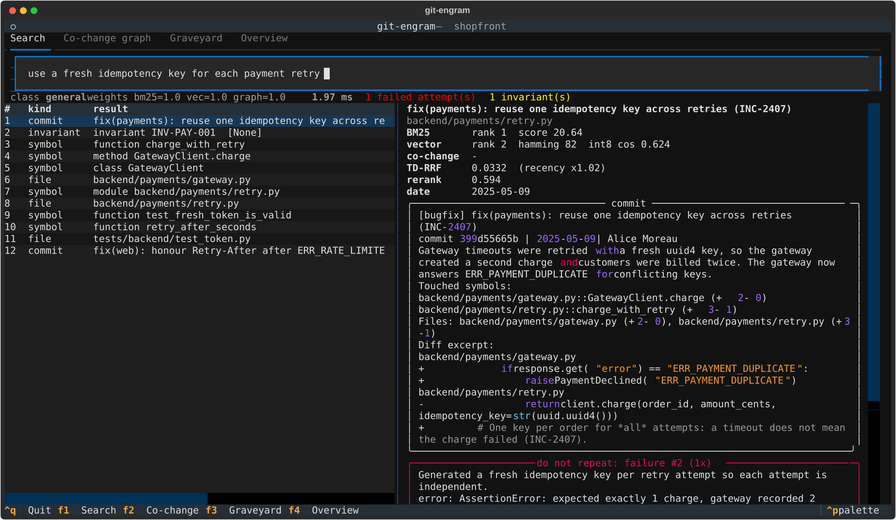
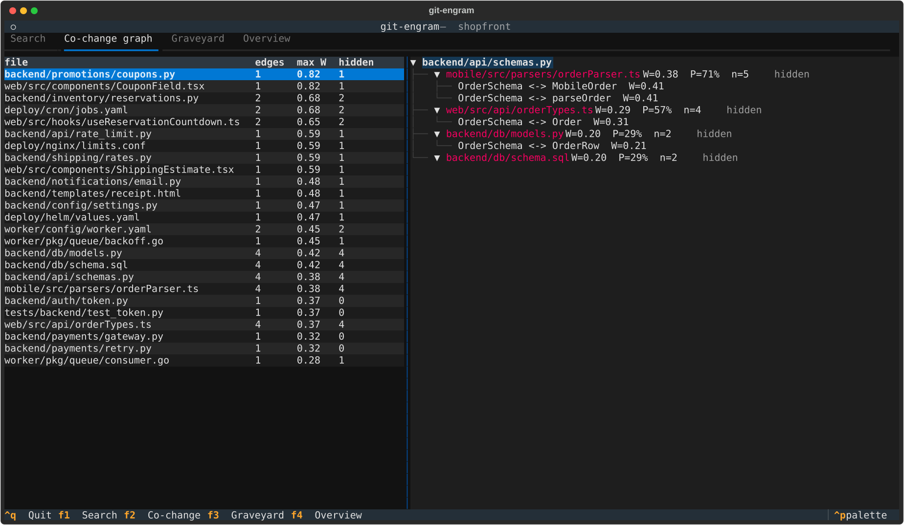
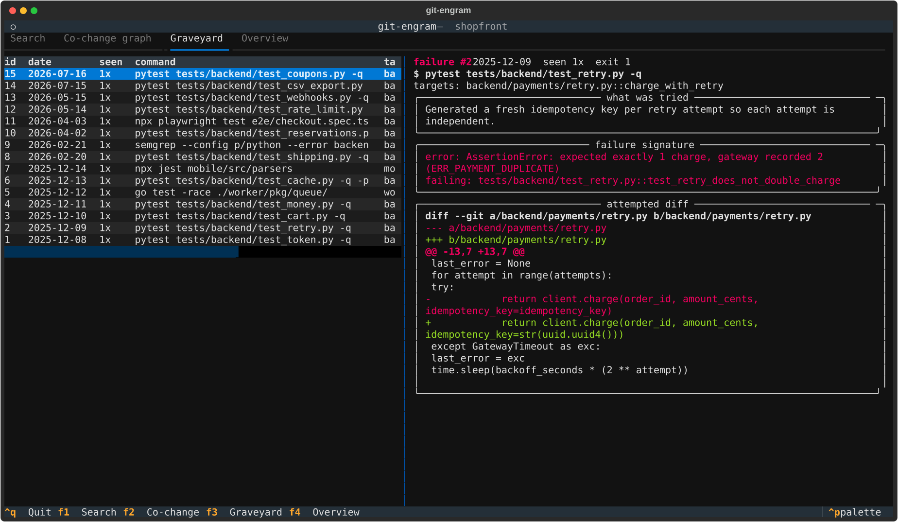

<div align="center">

# git-engram

**Your coding agent forgets *why* the code is the way it is. git-engram remembers.**

A local-first **Spatio-Temporal, Causal & Negative RAG** memory engine for AI coding agents,<br>
served over the **Model Context Protocol** in ~2 ms. No LangChain, no LlamaIndex, no GPU, no network.


</div>

---

**Contents:** [The problem](#the-problem-causal-amnesia) · [What the agent sees](#what-the-agent-sees) ·
[Benchmark](#benchmark) · [Architecture](#architecture) · [Quickstart](#quickstart) · [MCP tools](#mcp-tools) ·
[CLI](#cli) · [Dashboard](#interactive-dashboard) · [Python API](#python-api) ·
[Data & privacy](#what-is-stored-and-what-stays-local) · [Configuration](#configuration) ·
[Dogfooding](#dogfooding-git-engram-on-itself) · [Development](#development) · [Limitations](#limitations) ·
[Roadmap](#roadmap)

## The problem: Causal Amnesia

Code RAG indexes what the code **is**. Agents break things because of what the code **was**:

1. **They delete load-bearing code.** That odd `- CLOCK_SKEW_SECONDS` looks redundant, but it fixed a production
   incident eight months ago. The explanation lives in a commit message nobody retrieves.
2. **They repeat failed attempts.** Yesterday's session tried a fresh idempotency key per retry, broke the tests
   and ran `git checkout .`. The diff and the stack trace are gone, so today's session tries it again.
3. **They miss hidden couplings.** `backend/api/schemas.py` and `mobile/src/parsers/orderParser.ts` share no import
   edge, but they changed together in 5 of 7 commits. Static analysis can't see that link. Git history can.

`git-engram` indexes **AST symbols × git causality × temporal co-change × failed attempts** and serves the
result to Claude Code, Cursor, OpenCode or Windsurf as one compact, sanitised context block.

## What the agent sees

Real output of `engram_preflight_check("backend/payments/retry.py", "charge_with_retry", "generate a fresh
idempotency key for every retry attempt")` on the benchmark repository (trimmed):

```xml
<engram_preflight file="backend/payments/retry.py" symbol="charge_with_retry" latency_ms="12.55">
<invariants must_hold>
  <invariant id="INV-PAY-001" severity="critical" scope="backend/payments/**">Every gateway charge must reuse ONE
  idempotency key per order across all retries; never create keys inside the retry loop (INC-2407).</invariant>
</invariants>
<anti_context_do_not_repeat>
These approaches were ALREADY TRIED in this repository and FAILED. Do not repeat them; ...
  <failed_attempt id="2" date="2025-12-09" occurrences="1" exit_code="1">
    targets: backend/payments/retry.py::charge_with_retry
    command: pytest tests/backend/test_retry.py -q
    what was tried: Generated a fresh idempotency key per retry attempt so each attempt is independent.
    failure signature:
      error: AssertionError: expected exactly 1 charge, gateway recorded 2 (ERR_PAYMENT_DUPLICATE)
      failing: tests/backend/test_retry.py::test_retry_does_not_double_charge
    attempted diff (excerpt):
      -            return client.charge(order_id, amount_cents, idempotency_key=idempotency_key)
      +            return client.charge(order_id, amount_cents, idempotency_key=str(uuid.uuid4()))
    matched because: same symbol backend/payments/retry.py::charge_with_retry; error-signature term overlap 100%
  </failed_attempt>
</anti_context_do_not_repeat>
<load_bearing_code why_this_code_exists>
  ! 3 line(s) of charge_with_retry (23%) were written by 399d55665b [bugfix] "fix(payments): reuse one idempotency
    key across retries (INC-2407)" -- removing them may re-open that bugfix.
</load_bearing_code>
<causal_history>
  2025-05-09 399d55665b [bugfix] fix(payments): reuse one idempotency key across retries (INC-2407) (+3 -1)
      +     idempotency_key = f"{order_id}:{uuid.uuid5(uuid.NAMESPACE_URL, order_id)}"
      -             return client.charge(order_id, amount_cents, idempotency_key=str(uuid.uuid4()))
</causal_history>
<co_change_coupling>
  backend/payments/gateway.py  W=0.49  P(changes|target changes)=100%  co-commits=2  [import-linked]
</co_change_coupling>
</engram_preflight>
```

The agent now knows the rule, why it exists, the exact patch that already failed, and what else has to change.
(12.55 ms is a cold one-shot CLI process; inside the long-running MCP server the same call takes 1.4–2.3 ms.)

---

## Benchmark

`git-engram benchmark` builds a reproducible synthetic monorepo (Python API, TypeScript web + mobile, Go worker,
YAML/SQL/HTML/nginx) with 65 dated commits. It contains real-looking bugfixes, a perf "optimisation" that was
reverted, hidden cross-language couplings, a poisoned vendored file, and 15 failed agent attempts in the Graveyard.

Every configuration sees **the same corpus, the same embedder and the same FTS5 index**. Baselines get the failure
records as ordinary documents. For their ranking metrics, failures are filtered out (the most generous treatment);
their warning hit-rate counts a relevant failure anywhere in the unfiltered top-5.

### Evaluation protocol

The queries come in six splits ([`dataset.py`](src/git_engram/evals/dataset.py)). Every held-out split was committed
before the change it evaluates; `git merge-base --is-ancestor` verifies each pair:

| split | queries | status | committed in |
|---|---:|---|---|
| dev / calibration | 48 | every weight, threshold and design choice was made looking at these (behavioral `6f9e13e`, NL bug reports `7e41bc1`) | `54dc0c0` |
| held-out v1 | 24 | retired: used to diagnose commit crowding | `d049d5e`, before the router `1a7d202` |
| held-out v2 | 24 | retired: used to diagnose false alarms | `cc98b38`, before the slot budget `20cdcec` |
| held-out v3 | 24 | retired: used to diagnose the causal regression and sibling false alarms | `df0f18b`, before symbol anchoring `3ab2409` |
| held-out v4 | 30 | retired: used to diagnose warning recall and regression routing | `91ea29f`, before code-first routing and gating `a4f0cba` |
| held-out **v5** | 30 | **headline**: promotions / CSV-export extension, natural-language bug reports, sibling probes | `f6a6f0f`, before the top-commit trigger and symptom routing `8465b92` |

During the v4 round, one v4 query ran once in a unit test before the final evaluation (settings were already frozen).
A guard test (`test_no_test_file_contains_held_out_query_text`) now covers every held-out split, and no held-out
query was executed before its evaluation this round.

### Held-out v5: 30 unseen queries (headline)

| Configuration | Recall@3 | Recall@5 | MRR | nDCG@5 | Neg. Warning Hit | False Alarms | Co-Change Disc. | Index RAM (KB) | P50 (ms) | P95 (ms) |
|---|---:|---:|---:|---:|---:|---:|---:|---:|---:|---:|
| Dense RAG (float32 cosine) | 0.778 | 0.817 | 0.850 | 0.771 | **100%** | 12% | 67% | 360.0 | 0.16 | 0.23 |
| BM25 only (SQLite FTS5) | 0.756 | 0.817 | 0.874 | 0.803 | 83% | **0%** | 67% | **74.0** | 0.30 | 0.40 |
| Hybrid (BM25 + float32, RRF) | 0.761 | 0.833 | 0.899 | 0.826 | 83% | 4% | 67% | 434.0 | 0.38 | 0.56 |
| **git-engram** (full) | **0.800** | **0.872** | **0.967** | **0.902** | **100%** | 8% | **83%** | 149.4 | 1.60 | 2.18 |

| nDCG@5, held-out v5 | causal "why" | behavioral "why" | NL bug reports | coupled-file | error-code |
|---|---:|---:|---:|---:|---:|
| Dense RAG (float32) | 0.754 | **1.000** | 0.764 | 0.564 | 0.774 |
| BM25 only | 0.902 | 0.929 | 0.828 | 0.468 | **0.889** |
| Hybrid (BM25 + float32) | 0.922 | 0.994 | 0.802 | 0.526 | 0.886 |
| **git-engram** | **0.942** | 0.991 | **0.878** | **0.824** | 0.874 |

**Retired splits, current engine** (nDCG@5 vs BM25 · warning hit rate · false alarms): v4 **0.832** vs 0.753 · 100% ·
14%; v3 **0.842** vs 0.751 · 86% · 24%; v2 **0.872** vs 0.784 · 100% · 6%; v1 **0.830** vs 0.757 · 80% · 5%.
**Dev** (optimistic): **0.818** vs 0.735, warning hit rate 90%, false alarms 7%. Full tables:
[`benchmarks/RESULTS.md`](benchmarks/RESULTS.md).

**Ablations:** each row changes one component, measured on dev and held-out v5.

| Variant | nDCG@5 dev | nDCG@5 **v5** | Recall@5 v5 | MRR v5 | Co-Change v5 | Neg. Hit v5 | False Alarms v5 |
|---|---:|---:|---:|---:|---:|---:|---:|
| git-engram (full) | 0.818 | 0.902 | 0.872 | 0.967 | 83% | 100% | 8% |
| − direct top-commit warning trigger | 0.818 | 0.902 | 0.872 | 0.967 | 83% | 67% | 8% |
| − broad symptom routing (old rules) | 0.812 | 0.893 | 0.872 | 0.950 | 83% | 83% | 8% |
| symptom co-change expansion on (graph 0.3) | 0.816 | 0.902 | 0.872 | 0.967 | 83% | 100% | 8% |
| − commit-relevance gate (any top-3 commit) | 0.818 | 0.902 | 0.872 | 0.967 | 83% | 100% | 42% |
| file-level graveyard anchoring (legacy) | 0.818 | 0.902 | 0.872 | 0.967 | 83% | 100% | 50% |
| − code-first behavioral route | 0.820 | 0.855 | 0.872 | 0.900 | 83% | 100% | 4% |
| − named-symbol pinning | 0.812 | 0.902 | 0.872 | 0.967 | 83% | 100% | 8% |
| − commit slot budget | 0.802 | 0.900 | 0.872 | 0.967 | 83% | 100% | 8% |
| − query-adaptive router | 0.765 | 0.826 | 0.889 | 0.867 | 83% | 83% | 8% |
| − exact-identifier rerank profile | 0.818 | 0.896 | 0.872 | 0.967 | 83% | 100% | 12% |
| + MMR file diversity (opt-in) | 0.818 | 0.886 | 0.844 | 0.967 | 83% | 100% | 8% |
| − co-change graph path | 0.794 | 0.894 | 0.861 | 0.961 | 67% | 100% | 8% |
| − interaction reranker | 0.606 | 0.855 | 0.894 | 0.906 | 83% | 83% | 4% |
| − time decay (plain RRF) | 0.821 | 0.889 | 0.861 | 0.967 | 67% | 100% | 4% |
| float32 exact instead of 1-bit + int8 | 0.818 | 0.902 | 0.872 | 0.967 | 83% | 100% | 8% |

**`engram_preflight_check` latency:** P50 **1.11 ms**, P95 **1.83 ms** (warm MCP server, 7 targets × 30 runs).

**Two-stage quantized search at scale** (synthetic Dirichlet topic mixtures of the corpus embeddings, 400 candidates):

| Vectors | Recall@10 vs float32-384d | Recall@10 vs float32-256d | Two-stage P50 | float32 P50 | Two-stage RAM | float32 RAM |
|---:|---:|---:|---:|---:|---:|---:|
| 10,000 | 0.874 | 0.990 | 0.18 ms | 0.23 ms | 2.8 MB | 14.6 MB |
| 100,000 | 0.733 | 0.970 | **0.62 ms** | 2.44 ms | **27.8 MB** | 146.5 MB |

**Context firewall:** 12/12 injection payloads detected and neutralised; 0/12 benign snippets modified.

Apple M-series, Python 3.14, single thread. Latencies vary up to ~2× between runs on the same machine depending on
load; quality metrics are deterministic. Raw numbers: [`benchmarks/RESULTS.md`](benchmarks/RESULTS.md),
[`benchmarks/results.json`](benchmarks/results.json). Reproduce with `git-engram benchmark`.

### Reading the numbers honestly

- **Both v4 targets were met on unseen data.** Warning recall is **100%** on v5 (67% without the direct top-commit
  trigger) and 100% on retired v4 (was 62%). Natural-language bug reports score **0.878 vs 0.828** for BM25; on
  retired v4 it is 0.824 vs 0.764, which was the gap the previous round left open. Broad symptom routing sent all 6
  v5 bug reports to the `symptom` route.
- **False alarms: 8% on v5**, under the ~14% target and below dense (12%), but above BM25 (0%) and hybrid (4%). The
  trigger has a cost on the split built to probe sibling false alarms: retired v3 rose from 18% to **24%** (BM25 12%).
  A sibling's *fix* commit that ranks #1 now credits its functions directly. The conjunctive gate is still doing
  most of the work: without it v5 false alarms are 42%.
- **What did not matter.** Damping co-change expansion on symptom routes is neutral on both dev and v5; the
  regression gain came from routing plus allowing two commits in the top 5. Pinning was neutral on v5.
- **Where git-engram does not lead.** Exact-identifier queries (0.874 vs BM25 0.889), behavioral queries (dense hits
  1.000 vs 0.991), and false alarms vs BM25. v5 is also easier than earlier splits for every configuration: all
  baselines score higher on it than on dev or v4, so its absolute numbers flatter everyone, not just git-engram.
- **Quantization is free here.** On every split the two-stage 1-bit → int8 search gives *identical* metrics to exact
  float32. At 100k vectors it keeps 97% of the same-dimension float32 top-10 in 5.3× less RAM and runs ~4× faster.
- **Still synthetic.** One generated repository and 180 queries. Treat the numbers as evidence for the mechanisms,
  not as a universal leaderboard.

---

## Architecture


```
src/git_engram/
├── indexer/      ast_chunker · gitio (log/cat-file/blame plumbing) · history (capsules) · cochange · pipeline
├── embeddings/   hashing-LSA (offline) · ONNX backend · quantization (MRL/int8/1-bit) · two-stage vector index
├── retrieval/    lexical (FTS5 BM25) · graph (spreading activation) · fusion (TD-RRF) · reranker · engine
├── graveyard/    failure store · signature extraction · `exec` watcher
├── security/     context firewall (invisible Unicode, injection rules, perplexity LM)
├── invariants.py OKF invariants        engine.py  facade        render.py  agent-facing context blocks
├── mcp/server.py MCP stdio server      cli/main.py  Rich CLI    evals/  fixture · dataset · metrics · runner
```

### 1. Spatio-temporal AST indexing

Every file is chunked into **symbols**: functions, classes, methods, types, plus a `<module>` remainder for
constants and imports. Python uses CPython's `ast`. Other languages use tree-sitter when a grammar is cached
locally, otherwise a lexer-aware structural parser (declaration patterns plus a brace matcher that skips strings,
comments and parameter lists). A test asserts both backends produce identical symbol names on the fixture.

History is attributed **per symbol, not per file**. Each touched file is re-parsed *at that commit* and *at its
parent* (`git cat-file --batch`), and every `-U0` hunk is resolved to the most specific enclosing symbol. That gives a
`git log -L`-style trail for every function in one streaming pass, with renames followed. `git blame` adds line
ownership, so the preflight can say *"23% of this function was written by a bugfix commit"*.

Each commit becomes a deterministic **Causal Capsule**: intent (`bugfix | security | revert | perf | feature |
refactor | …`), message, touched symbols with `+/−` counts, and a diff excerpt. These capsules are documents
alongside code, so "why" questions retrieve the commit that answers them.

### 2. Two-stage 1-bit Hamming + Matryoshka int8 retrieval

Vectors are stored three ways in SQLite BLOBs and loaded into contiguous NumPy arrays:

| tier | content | bytes (384→256d) |
|---|---|---:|
| `bin` | sign bits of $R\,\hat v_{1:256}$ (random orthogonal $R$), packed, bit-sliced | 32 |
| `i8` | symmetric per-vector int8 of $\hat v_{1:256}$ | 256 |
| `f32` | full vector, disk only (baselines / re-quantisation) | 1536 |

**Matryoshka truncation.** $\hat v_{1:d} = v_{1:d} / \lVert v_{1:d} \rVert$. The default offline embedder
(feature hashing → TF-IDF → randomized truncated SVD) orders components by singular value. By Eckart–Young, every
prefix is then the best rank-$d$ approximation, which is exactly the property MRL-trained neural models learn.

**Stage 1: Hamming.** Raw sign bits work badly for spectrally concentrated embeddings: a document with exact rank 5
landed at Hamming rank 112. git-engram first applies a fixed Haar-random rotation (SimHash). The bit-flip
probability is then the angle,

$$\Pr\big[\mathrm{sgn}(r_j^\top x)\neq \mathrm{sgn}(r_j^\top y)\big] = \frac{\theta(x,y)}{\pi},$$

so $\mathbb{E}[d_H]/d = \theta/\pi$. This is verified in `tests/test_quantization.py`, and it lifted stage-1
recall@10 from 0.49 to 0.91. Distances are computed as `popcount(XOR)` on a **bit-sliced, column-major** layout
(one contiguous `uint64` lane per 64 bits across all vectors). That is 13× faster than the row-major form in NumPy.
Top-C selection is an O(n) counting select over the 0…256 distance histogram.

**Stage 2: asymmetric int8 rescoring** of the C candidates with the float32 query:
$\cos(q, \tilde d) = \frac{q^\top \tilde d}{\lVert q\rVert\,\lVert \tilde d\rVert}$, where the per-vector scale cancels.

### 3. Temporal Co-Change Graph

For nodes $A,B$ (files *and* symbols) with commit sets $C_A, C_B$:

$$W(A,B) \;=\; \frac{\displaystyle\sum_{c\,\in\, C_A \cap C_B} e^{-\lambda\,(t_{\text{now}} - t_c)}}{\sqrt{|C_A|\cdot|C_B|}}, \qquad \lambda = \frac{\ln 2}{t_{1/2}}$$

This is a time-decayed Ochiai/cosine coefficient. git-engram also stores the directed confidence
$P(B\mid A) = |C_A\cap C_B|/|C_A|$. Bulk commits (more than 40 files) are dropped, edges need at least 2
co-commits, and every edge is labelled **hidden** when neither file imports the other.
`t_now` is the newest indexed commit, so results are reproducible and a quiet repo is not penalised.

### 4. Tri-path retrieval with Time-Decayed RRF

Path 1 (FTS5 BM25) and path 2 (two-stage vectors) run in parallel. Their preliminary fusion seeds **path 3**, a
one-hop spreading activation that surfaces files *outside* the current top results. Import-linked neighbours are
discounted, because static analysis already finds them:

$$a(v) = \delta \sum_{s \in \text{seeds}} a(s)\, W(s,v)\,\gamma^{\,\mathbf{1}[\text{import-linked}(s,v)]}$$

The three rankings are fused with **Time-Decayed Reciprocal Rank Fusion**:

$$\mathrm{Score}(d) = \sum_{m \in \{\text{BM25},\,\text{Vec},\,\text{Graph}\}} \frac{w_m}{k + \mathrm{rank}_m(d)} \cdot \left(1 + \alpha\, e^{-\lambda \Delta t_d}\right)$$

Here $\Delta t_d$ is the age of the document's last change: the last commit touching that symbol, the commit itself,
or the failure time. Defaults: $k=60$, $w_m=1$, $\alpha=0.25$, $t_{1/2}=120$ days.

The top 30 are then **reranked** by a pluggable cross-scorer. The default is a deterministic interaction model over
the (query, document) pair: IDF-weighted term coverage, field matches, bigram proximity, verbatim identifier/error-code
hits, int8 cosine, query-intent vs document-kind agreement, and graph activation. An ONNX cross-encoder can replace it
(`retrieval.cross_encoder_dir`). **MMR file diversity**, which penalises several documents from the same file, is
available as an opt-in (`retrieval.mmr`). It is off by default because it lowered held-out nDCG@5 on two consecutive
unseen splits.

### 4b. Query-adaptive router

Before fusion, a deterministic classifier inspects surface features of the query and picks per-query path weights
and the reranker's intent ([`router.py`](src/git_engram/retrieval/router.py)). Precedence is first match wins:

| class | trigger | $w_{\text{BM25}}$ | $w_{\text{vec}}$ | $w_{\text{graph}}$ | reranker prefers |
|---|---|---:|---:|---:|---|
| `behavioral` | "why does/is `<named function>` …" with no history cue | 1.2 | 1.0 | 0.3 | neutral; the named symbol is **pinned to rank 1** |
| `causal` | why / reason / purpose / rationale / explain (incl. was/did/changed/reverted) | 1.0 | 1.0 | 0.5 | commits, failures |
| `change` | imperative add / change / rename / tune / raise ... | 1.0 | 1.0 | **1.3** | code |
| `exact` | commit hash, `ERR_X` / `E4012` / `INC-123`, exception name, quoted string, file path | **2.0** | 0.4 | 0.2 | verbatim token hits |
| `symptom` | natural-language bug report: "billed twice", silent drops, stale state, "kept / stopped / ended up", past-tense narratives | 1.2 | 1.0 | **0** (expansion off) | commits that fixed it (2 slots) |
| `general` | anything else | 1.0 | 1.0 | 1.0 | auto |

Routing costs microseconds and never looks at the corpus. The weights were set once, from the reasoning above, and
checked on the dev split only. The class and the weights used are returned with every search (`query_class`,
`fusion_weights`) and shown by `git-engram query` and the TUI.

### 4c. Commit slot budget and parent-symbol attachment

Commit capsules are often the best lexical *and* semantic match for a question, so an unconstrained ranker can fill 3–4
of the top 5 with them and push the code the agent must edit to rank 6+. The final top-k assembly is therefore
**stratified**: at most $c_{\text{class}}$ commit capsules may occupy the first 5 slots, where

$$c_{\text{causal}} = 3,\quad c_{\text{behavioral}} = c_{\text{symptom}} = c_{\text{exact}} = c_{\text{general}} = 2,\quad c_{\text{change}} = 0 .$$

Excess commits are **deferred** to rank 6+, never dropped. To keep the causal context those slots used to carry, every
code hit gets **attached commits**: the commits that modified that exact symbol, preferring ones that were retrieval
candidates and load-bearing (`bugfix`/`security`/`revert`). They render as `why:` lines under the result. The caps
were chosen on the dev split only, and the benchmark metric does **not** credit attachments.

**Named-symbol pinning.** For `behavioral`, `exact` and `change` queries, a symbol the query names exactly (a
qualified name like `TTLCache.set` or a distinctive identifier like `sign_webhook`; generic words never match) is
guaranteed rank 1, even if the ranker missed it. On held-out v4, removing the behavioral route costs −0.061
nDCG@5 and removing pinning −0.019.

### 5. Negative RAG: the Graveyard Index

`git-engram exec -- pytest -x` is a transparent wrapper: output is teed live and the exit code is preserved. On a
non-zero exit it snapshots `git diff HEAD` plus small untracked files and extracts a **failure signature** (pytest,
Python tracebacks, Go `--- FAIL`/`DATA RACE`, Rust `error[E…]`/panics, Jest, tsc). It maps the changed lines (not the
context lines) to the AST symbols they touched and stores the attempt. Repeats are de-duplicated by a fingerprint
that ignores addresses, durations, hunk offsets and whitespace, and the occurrence count goes up.

At query time a failure is surfaced when

$$\underbrace{0.75\,[\text{same symbol}] \;\big|\; 0.5\,[\text{same file}] \;\big|\; 0.3\,[\text{targets a retrieved symbol}]}_{\text{structural}} \;+\; 0.6\cdot\max\!\big(\cos(q,f),\ \text{cov}_{\text{idf}}(q,f)\big) \;\ge\; 0.40$$

The threshold means a failure needs either a strong textual match alone, or a moderate one *anchored to the code
being retrieved*. Anchoring is **symbol-level**: a failure whose diff touched a named function only earns the 0.3 when that same
function is retrieved in the top 3. Retrieved commits add evidence in two ways. A **load-bearing** commit
(bugfix / security / revert) that ranks **#1**, or scores above 0.65, is a **direct trigger**: every function it
modified earns 0.40, enough to warn on its own, because when the top answer *is* the fix, an attempt to re-break
that function is relevant. Any other commit goes through the **commit-relevance gate**: at least 0.9 × the best
score in the top 3, not a bulk commit (more than 8 symbols), and the failure's function must *also* be among the
top-5 code hits. Failures outside any named symbol fall back to file-level matching. In preflight, a *different*
function of the target file weighs only 0.25. Matches render in an `<anti_context_do_not_repeat>` block with the
failed diff and the reason.

### 6. Context firewall (CamoLeak / PoisonedRAG defence)

All text leaving the engine is scanned:

- **Invisible Unicode is stripped**: tag-block "ASCII smuggling" (the hidden payload is decoded and reported),
  zero-width characters, bidi overrides (Trojan Source), variation selectors and other `Cf` code points. Legitimate
  emoji ZWJ sequences are kept.
- **Injections are redacted in place** after NFKC normalisation, which defeats full-width obfuscation: instruction
  overrides, fake chat/tool delimiters, markdown image beacons and `camo` proxies (the CamoLeak exfil channel),
  secret-exfiltration phrasing, `curl | sh`, and destructive orders aimed at agents.
- **High-perplexity spans are flagged.** A hashed character-trigram LM is trained on *your* repository and
  calibrated at 1.5 × its own 99.5th-percentile window perplexity, so it catches GCG-style suffixes without being
  confused by your codebase's dialect. It only activates once the corpus is large enough to calibrate.

### 7. OKF invariants

`.engram/invariants.okf.json` is version-controlled team knowledge: globs, optionally narrowed to symbols
(`backend/api/schemas.py::Order*`). Matching is a precompiled regex. No retrieval or scoring is involved, so a
matching invariant *always* fires.

---

## Quickstart

**Requirements:** Python 3.11+ and `git` on `PATH`. Runtime dependencies are `numpy`, `pydantic`, `rich` and `mcp`;
no GPU, no network access and no API keys.

```bash
pipx install "git+https://github.com/giuseppegambino92/git-engram"   # or: uv tool install git+https://...
cd your-repo
git-engram index                   # AST + history + co-change graph + embeddings
git-engram preflight src/auth/token.py -s is_token_expired -i "remove the grace period"
```

From a clone: `pipx install .` (or `uv tool install .`). Optional extras: `[tui]` for the dashboard, `[treesitter]`
for tree-sitter grammars, `[onnx]` for neural embeddings and cross-encoders, e.g.
`pipx install ".[tui,treesitter]"`. A PyPI release is planned.

### Claude Code

```bash
claude mcp add --scope project git-engram -- git-engram mcp
```

or commit a `.mcp.json` ([`examples/claude-code.mcp.json`](examples/claude-code.mcp.json)):

```json
{ "mcpServers": { "git-engram": { "command": "git-engram", "args": ["mcp"] } } }
```

### Cursor / Windsurf / OpenCode

`.cursor/mcp.json` ([`examples/cursor.mcp.json`](examples/cursor.mcp.json)):

```json
{ "mcpServers": { "git-engram": { "command": "git-engram", "args": ["-C", "${workspaceFolder}", "mcp"] } } }
```

Then add the snippet in [`examples/AGENTS.md`](examples/AGENTS.md) to your `CLAUDE.md` / `AGENTS.md` / `.cursorrules`
so the agent calls preflight before editing and runs tests through `git-engram exec`.

### MCP tools

| tool | purpose |
|---|---|
| `engram_preflight_check(file_path, symbol_name?, intended_change_query?)` | AST context, why-the-code-exists, load-bearing lines, co-change coupling, invariants, anti-context |
| `engram_search_causal_history(query, top_k?, file_path?)` | tri-path hybrid search over code, commit capsules, failures and invariants |
| `engram_record_failure(file_path, attempted_diff, error_trace, notes?, symbol_name?, command?)` | write a failed approach to the Graveyard (indexed immediately) |
| `engram_record_invariant(rule_id, scope, invariant_description, severity?)` | store a deterministic OKF invariant |

The server answers the MCP handshake immediately and indexes in the background on first launch. When `HEAD` moves
it re-indexes incrementally; the check is a `stat`/read of `.git/HEAD`, not a subprocess.

## CLI

```bash
git-engram index [path] [--rebuild]          # incremental by default (content hashes + last..HEAD)
git-engram query "why does X ..." [--file F] [--mode full|bm25|dense|hybrid] [--raw|--json]
git-engram preflight FILE [-s SYMBOL] [-i "intended change"] [--json]
git-engram exec [--notes "..."] -- pytest -x  # exit code preserved; failures go to the Graveyard
git-engram invariant add RULE --scope "src/payments/**" --description "..." --severity critical
git-engram graveyard                          # list failed attempts
git-engram inspect                            # hidden-coupling hotspots, load-bearing files, memory footprint
git-engram benchmark [--out RESULTS.md --json results.json]
git-engram tui ["optional query"]             # interactive dashboard (also: git-engram inspect --tui)
git-engram mcp                                # stdio MCP server
```

`git-engram query` prints the full scoring breakdown for every hit: BM25 rank and score, Hamming distance, int8
cosine, graph activation, TD-RRF score, recency multiplier, rerank score and per-stage latency.

## Interactive dashboard

`pip install 'git-engram[tui]'`, then `git-engram tui`. It has four tabs, switched with `F1`–`F4`:

- **Search:** search-as-you-type over the full engine, with each path's evidence per hit (BM25 rank, Hamming
  distance, int8 cosine, co-change activation, TD-RRF, rerank). It shows the router class, the weights and the
  end-to-end latency, plus panels for anti-context, invariants and coupling alerts.
- **Co-change graph:** coupling hotspots, and every neighbour of the selected file with W, P(co-change) and
  hidden/import-linked status, expanded down to the symbol-level edges.
- **Graveyard:** every failed attempt with its command, failure signature and syntax-highlighted diff.
- **Overview:** index size, quantized vs. float32 memory, load-bearing hotspots and OKF invariants.

| Live search with anti-context | Hidden co-change graph | Graveyard diff browser |
|---|---|---|
|  |  |  |

The screenshots are real renders of the benchmark repository (`App.save_screenshot()`). `tests/test_tui.py` drives the
same app headlessly.

## Python API

Everything the CLI and the MCP server do is available from the `Engram` facade:

```python
from git_engram.engine import Engram
from git_engram.render import render_preflight

with Engram("path/to/repo") as engram:
    engram.index()                                   # incremental after the first run

    resp = engram.search("why does the cache take a lock on reads", top_k=5)
    print(resp.query_class, resp.fusion_weights)     # router decision, here "causal"
    for hit in resp.hits:
        print(hit.kind, hit.title, hit.bm25_rank, hit.vec_rank, hit.graph_rank, round(hit.score, 3))
    for warning in resp.warnings:                    # Negative RAG: failed attempts not to repeat
        print(warning.failure_id, warning.match_reason)

    report = engram.preflight("src/payments/retry.py", "charge_with_retry", "new key per retry")
    print(render_preflight(report))                  # the exact block an MCP client receives

    engram.record_failure(file_path="src/payments/retry.py", attempted_diff=diff_text,
                          error_trace=pytest_output, notes="tried a fresh key per retry")
    engram.record_invariant("PAY-1", "src/payments/**", "One idempotency key per order", "critical")
```

Results are typed pydantic models (`SearchResponse`, `Hit`, `FailureWarning`, `PreflightReport`), so `.model_dump_json()`
gives a stable JSON shape.

## What is stored, and what stays local

git-engram is local-first: it never opens a network connection, sends no telemetry and needs no API key. Everything
lives in `.engram/` at the repository root:

| path | content | commit it? |
|---|---|---|
| `.engram/engram.db` | SQLite (WAL): symbols, commit capsules, co-change graph, FTS5 index, quantized vectors, graveyard, embedder state | no (it is rebuilt from git; a `.engram/.gitignore` is created automatically) |
| `.engram/invariants.okf.json` | OKF invariants recorded via CLI/MCP | **yes**: it is shared team knowledge |
| `.engram/config.json` | optional configuration overrides | your choice |

The Graveyard stores the diffs and error output of failed attempts. That data stays in the local database and is only
ever returned through the context firewall. Delete `.engram/engram.db` to forget everything except the invariants.

## Dogfooding: git-engram on itself

This repository is built as atomic commits (`git log --oneline`), so git-engram can index its own history:

```console
$ git-engram index .
  files 72 · AST symbols 743 · commits 41 · documents 671 · co-change edges file/symbol 96/349
$ git-engram preflight src/git_engram/retrieval/engine.py -s HybridRetriever._slot_budget \
      -i "drop the commit cap from top-k assembly"
<ast_context>
  method HybridRetriever._slot_budget  src/git_engram/retrieval/engine.py:L342-L360
  blame ownership: 20cdcece [feature] 100%
</ast_context>
<causal_history>
  2026-11-13 20cdcece6e [feature] feat(retrieval): commit slot budget and parent-symbol commit attachment (+19 -0)
</causal_history>
<co_change_coupling>
  src/git_engram/config.py  W=0.83  P(changes|target changes)=83%  co-commits=5  [import-linked]
  src/git_engram/retrieval/router.py  W=0.82  P(changes|target changes)=67%  co-commits=4  [import-linked]
  tests/test_router.py  W=0.82  P(changes|target changes)=67%  co-commits=4  [hidden: no import link]
  tests/test_retrieval.py  W=0.73  P(changes|target changes)=67%  co-commits=4  [import-linked]
  src/git_engram/engine.py  W=0.73  P(changes|target changes)=67%  co-commits=4  [import-linked]
</co_change_coupling>
<related_memory>
  [symbol] function test_slot_budget_defers_instead_of_dropping  (tests/test_retrieval.py)
  ...
```

From its own history, git-engram learned that a change to the retrieval engine almost always needs a matching change
in `config.py` (83% of the time), and that `tests/test_router.py` is a *hidden* coupling: it changes with the engine
although it never imports it. The evaluation protocol is checkable the same way: `git merge-base --is-ancestor`
confirms that each held-out split was committed before the change it evaluates (see the benchmark section).

## Configuration

Optional `.engram/config.json`. Every knob of the math is explicit (see [`config.py`](src/git_engram/config.py)); the
values below are the defaults:

```json
{
  "embedding": { "backend": "hashing-lsa", "full_dim": 384, "mrl_dim": 256, "onnx_model_dir": null },
  "retrieval": {
    "rrf_k": 60, "w_bm25": 1.0, "w_vec": 1.0, "w_graph": 1.0, "adaptive_routing": true,
    "recency_alpha": 0.25, "recency_half_life_days": 120, "stage1_candidates": 400, "rerank_top_n": 30,
    "commit_slots": { "causal": 3, "behavioral": 2, "symptom": 2, "change": 0, "exact": 2, "general": 2 },
    "pin_position": 1, "pin_classes": ["behavioral", "exact", "change"],
    "mmr": false, "diversity_penalty": 0.1, "cross_encoder_dir": null
  },
  "graph": { "half_life_days": 365, "max_files_per_commit": 40, "min_support": 2 },
  "graveyard": {
    "semantic_threshold": 0.40, "context_weight": 0.30, "textual_weight": 0.60, "sibling_weight": 0.25,
    "anchor": "symbol", "commit_gating": true, "commit_gate": 0.9, "gate_code_hits": 5,
    "commit_trigger_rank1": true, "commit_trigger_score": 0.65, "trigger_weight": 0.40,
    "trigger_intents": ["bugfix", "security", "revert"]
  },
  "index": { "max_commits": 5000, "blame": true, "tree_sitter": true, "allow_grammar_download": false }
}
```

**Neural models** (`pip install 'git-engram[onnx]'`): point `embedding.backend: "onnx"` and `onnx_model_dir` at any
exported encoder (`model.onnx` + `tokenizer.json`, optional `engram_model.json` with `query_prefix` /
`document_prefix`). Examples are nomic-embed-text-v1.5 or bge-small. MRL truncation and quantization apply
unchanged. `retrieval.cross_encoder_dir` does the same for an ONNX cross-encoder such as ms-marco-MiniLM-L-6-v2.
Both run on raw ONNX Runtime + `tokenizers`, with no torch.

## Development

```bash
uv venv && uv pip install -e ".[dev]"
pytest -q                                    # 143 tests, fully offline (Python 3.11 and 3.14 verified)
GIT_ENGRAM_NO_TREE_SITTER=1 pytest -q        # what CI runners without cached grammars execute
ruff check src tests
git-engram benchmark
```

The suite covers quantization math (Hamming kernels vs. an `unpackbits` reference, SimHash angle estimation, int8
error bounds, counting select), AST chunking for 5 languages, `git log` patch parsing and per-symbol attribution
across renames, the co-change formula against a hand computation, TD-RRF, spreading activation, `exec` auto-capture
through the real CLI, incremental re-indexing (including from a fresh process), the context firewall, OKF invariants, MCP tools in-process **and over
a real stdio subprocess**, the query router, the Textual dashboard (headless), the dev/test split integrity, and the
benchmark end to end. The benchmark test only asserts "beats every baseline" on the **dev** split; held-out numbers
are reported, never asserted or tuned against. The slot budget has tests for its caps, for deferring rather than
dropping, and for commit attachment. Symbol-level graveyard anchoring has tests for sibling functions, module-level
fallback, bulk-commit exclusion and preflight behaviour. Code-first routing, named-symbol pinning and the commit-relevance gate
have dedicated tests, and a guard test fails if any test file executes held-out query text.

## Limitations

- The offline hashing-LSA embedder only knows vocabulary seen at fit time. New terms in later documents are covered
  by BM25 and the Graveyard's lexical coverage until the next refit, which happens automatically once more than 30%
  new documents accumulate (or with `--rebuild`).
- History follows file renames that `git -M` detects. A *symbol* rename starts a new lineage.
- Merge commits are skipped (`--no-merges`); their changes are attributed through the merged commits.
- **Graveyard false alarms vs. BM25:** 8% on v5 and 24% on retired v3, where BM25 has 0% and 12%. A sibling
  function's *fix* commit that ranks #1 now triggers its functions directly. That trade bought warning recall
  (100% on v5 and v4).
- **Exact identifiers:** BM25 still leads slightly (0.889 vs 0.874 on v5).
- Some graveyard matches sit close to the 0.40 threshold, so re-fitting the embedder (`--rebuild`) can flip a
  purely textual warning. Warnings anchored to the same symbol (preflight) are robust.
- Tested in CI on Linux and macOS with Python 3.11, 3.12 and 3.13 (and locally on 3.14). Windows path handling is
  untested.

## Roadmap

- **Precision of the direct warning trigger.** Restrict it further (e.g. require the fix commit to have touched the
  *retrieved* function's file region) to bring false alarms on sibling-heavy code down to the BM25 level without
  losing the recall it restored. Like every change, this needs a fresh held-out split.
- **Exact-identifier ranking.** Close the remaining small gap to raw BM25 on error codes and ticket ids.
- **Real-repository evaluation.** Complement the synthetic fixture with an annotated benchmark on public repositories.
- **PyPI release** and pre-built ONNX model recipes.
- **Windows** path handling and CI coverage.

## Contributing

Issues and pull requests are welcome. Before opening a PR:

```bash
ruff check src tests && ruff format --check src tests
pytest -q && GIT_ENGRAM_NO_TREE_SITTER=1 pytest -q
git-engram benchmark            # attach the numbers if the change touches retrieval
```

Retrieval changes follow the evaluation protocol above: tune on `DEV_QUERIES` only. A claim of improvement needs a new
held-out split committed *before* the change, and `test_no_test_file_contains_held_out_query_text` must keep passing.

## License

MIT, see [`LICENSE`](LICENSE).
