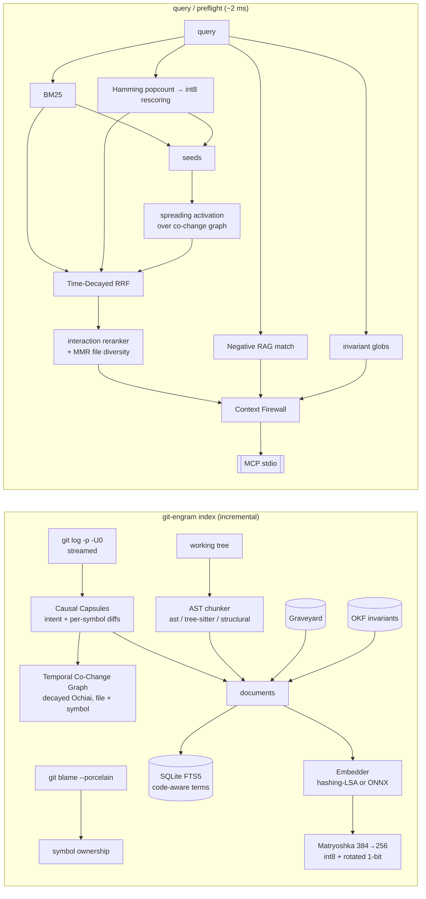

<div align="center">

# git-engram

**Your coding agent forgets *why* the code is the way it is. git-engram remembers.**

A local-first **Spatio-Temporal, Causal & Negative RAG** memory engine for AI coding agents,<br>
served over the **Model Context Protocol** in ~2 ms. No LangChain, no LlamaIndex, no GPU, no network.


</div>

---

## The problem: Causal Amnesia

Code RAG indexes what the code **is**. Agents break things because of what the code **was**:

1. **They delete load-bearing code.** That odd `- CLOCK_SKEW_SECONDS` looks redundant, but it fixed a production
   incident eight months ago. The explanation lives in a commit message nobody retrieves.
2. **They repeat failed attempts.** Yesterday's session tried a fresh idempotency key per retry, broke the tests
   and ran `git checkout .`. The diff and the stack trace are gone, so today's session tries it again.
3. **They miss hidden couplings.** `backend/api/schemas.py` and `mobile/src/parsers/orderParser.ts` share no import
   edge, but they changed together in 5 of 7 commits. Static analysis can't see that link. Git history can.

`git-engram` indexes **AST symbols × git causality × temporal co-change × failed attempts** and serves the
result to Claude Code, Cursor, OpenCode or Windsurf as one compact, sanitised context block.

## What the agent sees

Real output of `engram_preflight_check("backend/payments/retry.py", "charge_with_retry", "generate a fresh
idempotency key for every retry attempt")` on the benchmark repository (trimmed):

```xml
<engram_preflight file="backend/payments/retry.py" symbol="charge_with_retry" latency_ms="12.55">
<invariants must_hold>
  <invariant id="INV-PAY-001" severity="critical" scope="backend/payments/**">Every gateway charge must reuse ONE
  idempotency key per order across all retries; never create keys inside the retry loop (INC-2407).</invariant>
</invariants>
<anti_context_do_not_repeat>
These approaches were ALREADY TRIED in this repository and FAILED. Do not repeat them; ...
  <failed_attempt id="2" date="2025-12-09" occurrences="1" exit_code="1">
    targets: backend/payments/retry.py::charge_with_retry
    command: pytest tests/backend/test_retry.py -q
    what was tried: Generated a fresh idempotency key per retry attempt so each attempt is independent.
    failure signature:
      error: AssertionError: expected exactly 1 charge, gateway recorded 2 (ERR_PAYMENT_DUPLICATE)
      failing: tests/backend/test_retry.py::test_retry_does_not_double_charge
    attempted diff (excerpt):
      -            return client.charge(order_id, amount_cents, idempotency_key=idempotency_key)
      +            return client.charge(order_id, amount_cents, idempotency_key=str(uuid.uuid4()))
    matched because: same symbol backend/payments/retry.py::charge_with_retry; error-signature term overlap 100%
  </failed_attempt>
</anti_context_do_not_repeat>
<load_bearing_code why_this_code_exists>
  ! 3 line(s) of charge_with_retry (23%) were written by 399d55665b [bugfix] "fix(payments): reuse one idempotency
    key across retries (INC-2407)" -- removing them may re-open that bugfix.
</load_bearing_code>
<causal_history>
  2025-05-09 399d55665b [bugfix] fix(payments): reuse one idempotency key across retries (INC-2407) (+3 -1)
      +     idempotency_key = f"{order_id}:{uuid.uuid5(uuid.NAMESPACE_URL, order_id)}"
      -             return client.charge(order_id, amount_cents, idempotency_key=str(uuid.uuid4()))
</causal_history>
<co_change_coupling>
  backend/payments/gateway.py  W=0.49  P(changes|target changes)=100%  co-commits=2  [import-linked]
</co_change_coupling>
</engram_preflight>
```

The agent now knows the rule, why it exists, the exact patch that already failed, and what else has to change.
(12.55 ms is a cold one-shot CLI process; inside the long-running MCP server the same call takes ~1.4 ms.)

---

## Benchmark

`git-engram benchmark` builds a reproducible synthetic monorepo (Python API, TypeScript web + mobile, Go worker,
YAML/SQL/HTML) with 37 dated commits. It contains real-looking bugfixes, a perf "optimisation" that was reverted, five
hidden cross-language couplings, a poisoned vendored file, and 7 failed agent attempts in the Graveyard. It then runs
**32 ground-truth queries**: 8 causal "why", 8 bug-regression, 8 coupled-file and 8 exact-identifier.

Every configuration sees **the same corpus, the same embedder and the same FTS5 index**. Baselines get the failure
records as ordinary documents. For their ranking metrics, failures are filtered out (the most generous treatment);
their warning hit-rate counts a relevant failure anywhere in the unfiltered top-5.

| Configuration | Recall@3 | Recall@5 | MRR | nDCG@5 | Neg. Warning Hit | False Alarms | Co-Change Disc. | Index RAM (KB) | P50 (ms) | P95 (ms) |
|---|---:|---:|---:|---:|---:|---:|---:|---:|---:|---:|
| Dense RAG (float32 cosine) | 0.583 | 0.703 | 0.764 | 0.629 | 87% | 6% | 0% | 229.5 | 0.23 | 0.37 |
| BM25 only (SQLite FTS5) | 0.651 | 0.734 | **0.885** | 0.739 | 67% | **0%** | 0% | **47.0** | 0.31 | 0.49 |
| Hybrid (BM25 + float32, RRF) | 0.630 | 0.719 | 0.829 | 0.704 | 73% | 6% | 0% | 276.5 | 0.40 | 0.63 |
| **git-engram** (full) | **0.740** | **0.781** | 0.878 | **0.793** | **93%** | 6% | **62%** | 95.5 | 1.76 | 2.65 |

| nDCG@5 by category | causal "why" | regression | coupled-file | error-code |
|---|---:|---:|---:|---:|
| Dense RAG (float32) | 0.628 | 0.788 | 0.370 | 0.730 |
| BM25 only | 0.812 | 0.907 | 0.435 | **0.803** |
| Hybrid (BM25 + float32) | 0.754 | **0.909** | 0.412 | 0.741 |
| **git-engram** | **0.948** | 0.860 | **0.579** | 0.786 |

**Ablations**: each row removes one component.

| Variant | Recall@5 | MRR | nDCG@5 | Co-Change Disc. | Neg. Warning Hit |
|---|---:|---:|---:|---:|---:|
| git-engram (full) | 0.781 | 0.878 | 0.793 | 62% | 93% |
| − co-change graph path | 0.740 | 0.896 | 0.777 | 12% | 93% |
| − interaction reranker | 0.734 | 0.707 | 0.621 | 62% | 73% |
| − MMR file diversity | 0.781 | 0.885 | 0.797 | 38% | 93% |
| − time decay (plain RRF) | 0.724 | 0.855 | 0.760 | 62% | 93% |
| float32 exact instead of 1-bit + int8 | 0.781 | 0.878 | 0.793 | 62% | 93% |

**`engram_preflight_check` latency:** P50 **1.40 ms**, P95 **1.92 ms** (warm MCP server, 7 targets × 30 runs).

**Two-stage quantized search at scale** (synthetic Dirichlet topic mixtures of the corpus embeddings, 400 candidates):

| Vectors | Recall@10 vs float32-384d | Recall@10 vs float32-256d | Two-stage P50 | float32 P50 | Two-stage RAM | float32 RAM |
|---:|---:|---:|---:|---:|---:|---:|
| 10,000 | 0.831 | 0.982 | 0.20 ms | 0.27 ms | 2.8 MB | 14.6 MB |
| 100,000 | 0.738 | 0.968 | **0.66 ms** | 2.53 ms | **27.8 MB** | 146.5 MB |

**Context firewall:** 12/12 injection payloads detected and neutralised; 0/12 benign snippets modified.

Apple M-series, Python 3.14, single thread. Raw numbers: [`benchmarks/RESULTS.md`](benchmarks/RESULTS.md),
[`benchmarks/results.json`](benchmarks/results.json). Reproduce with `git-engram benchmark`.

### Reading the numbers honestly

- **Where it wins.** Causal "why" queries (+0.14 nDCG@5 over the best baseline), coupled-file discovery (62% vs 0%),
  failure warnings (93% vs ≤87%) and RAM (vectors 5× smaller than float32 at equal quality).
- **Where it does not.** On plain bug-regression queries BM25 is better (0.907 vs 0.860): graph expansion
  occasionally pulls a coupled file above a commit. BM25 also keeps the best MRR and the smallest index, and
  git-engram is ~5–6× slower than a single BM25 call. The extra time is the reranker and Negative-RAG work, and it is
  still ~2 ms.
- **Quantization is free here.** On the fixture the two-stage 1-bit → int8 search gives *identical* metrics to exact
  float32. At 100k vectors it keeps 97% of the same-dimension float32 top-10 and runs 3.8× faster in 5.3× less RAM.
  The lower "vs 384d" column is caused by MRL truncation of isotropic synthetic noise; real LSA spectra are lower-rank.
- **What was tuned.** The reranker weights are hand-set. The two Graveyard thresholds were chosen from the observed
  separation between related and unrelated failures on this fixture, and the MMR/graph-exclusion trade-off is shown
  in the ablation. There is no held-out set, and the fixture is synthetic: treat the numbers as evidence for the
  mechanisms, not as a universal leaderboard.

---

## Architecture



```
src/git_engram/
├── indexer/      ast_chunker · gitio (log/cat-file/blame plumbing) · history (capsules) · cochange · pipeline
├── embeddings/   hashing-LSA (offline) · ONNX backend · quantization (MRL/int8/1-bit) · two-stage vector index
├── retrieval/    lexical (FTS5 BM25) · graph (spreading activation) · fusion (TD-RRF) · reranker · engine
├── graveyard/    failure store · signature extraction · `exec` watcher
├── security/     context firewall (invisible Unicode, injection rules, perplexity LM)
├── invariants.py OKF invariants        engine.py  facade        render.py  agent-facing context blocks
├── mcp/server.py MCP stdio server      cli/main.py  Rich CLI    evals/  fixture · dataset · metrics · runner
```

### 1. Spatio-temporal AST indexing

Every file is chunked into **symbols**: functions, classes, methods, types, plus a `<module>` remainder for
constants and imports. Python uses CPython's `ast`. Other languages use tree-sitter when a grammar is cached
locally, otherwise a lexer-aware structural parser (declaration patterns plus a brace matcher that skips strings,
comments and parameter lists). A test asserts both backends produce identical symbol names on the fixture.

History is attributed **per symbol, not per file**. Each touched file is re-parsed *at that commit* and *at its
parent* (`git cat-file --batch`), and every `-U0` hunk is resolved to the most specific enclosing symbol. That gives a
`git log -L`-style trail for every function in one streaming pass, with renames followed. `git blame` adds line
ownership, so the preflight can say *"23% of this function was written by a bugfix commit"*.

Each commit becomes a deterministic **Causal Capsule**: intent (`bugfix | security | revert | perf | feature |
refactor | …`), message, touched symbols with `+/−` counts, and a diff excerpt. These capsules are documents
alongside code, so "why" questions retrieve the commit that answers them.

### 2. Two-stage 1-bit Hamming + Matryoshka int8 retrieval

Vectors are stored three ways in SQLite BLOBs and loaded into contiguous NumPy arrays:

| tier | content | bytes (384→256d) |
|---|---|---:|
| `bin` | sign bits of $R\,\hat v_{1:256}$ (random orthogonal $R$), packed, bit-sliced | 32 |
| `i8` | symmetric per-vector int8 of $\hat v_{1:256}$ | 256 |
| `f32` | full vector, disk only (baselines / re-quantisation) | 1536 |

**Matryoshka truncation.** $\hat v_{1:d} = v_{1:d} / \lVert v_{1:d} \rVert$. The default offline embedder
(feature hashing → TF-IDF → randomized truncated SVD) orders components by singular value. By Eckart–Young, every
prefix is then the best rank-$d$ approximation, which is exactly the property MRL-trained neural models learn.

**Stage 1: Hamming.** Raw sign bits work badly for spectrally concentrated embeddings: a document with exact rank 5
landed at Hamming rank 112. git-engram first applies a fixed Haar-random rotation (SimHash). The bit-flip
probability is then the angle,

$$\Pr\big[\operatorname{sgn}(r_j^\top x)\neq \operatorname{sgn}(r_j^\top y)\big] = \frac{\theta(x,y)}{\pi},$$

so $\mathbb{E}[d_H]/d = \theta/\pi$. This is verified in `tests/test_quantization.py`, and it lifted stage-1
recall@10 from 0.49 to 0.91. Distances are computed as `popcount(XOR)` on a **bit-sliced, column-major** layout
(one contiguous `uint64` lane per 64 bits across all vectors). That is 13× faster than the row-major form in NumPy.
Top-C selection is an O(n) counting select over the 0…256 distance histogram.

**Stage 2: asymmetric int8 rescoring** of the C candidates with the float32 query:
$\cos(q, \tilde d) = \frac{q^\top \tilde d}{\lVert q\rVert\,\lVert \tilde d\rVert}$, where the per-vector scale cancels.

### 3. Temporal Co-Change Graph

For nodes $A,B$ (files *and* symbols) with commit sets $C_A, C_B$:

$$W(A,B) \;=\; \frac{\displaystyle\sum_{c\,\in\, C_A \cap C_B} e^{-\lambda\,(t_{\text{now}} - t_c)}}{\sqrt{|C_A|\cdot|C_B|}}, \qquad \lambda = \frac{\ln 2}{t_{1/2}}$$

This is a time-decayed Ochiai/cosine coefficient. git-engram also stores the directed confidence
$P(B\mid A) = |C_A\cap C_B|/|C_A|$. Bulk commits (more than 40 files) are dropped, edges need at least 2
co-commits, and every edge is labelled **hidden** when neither file imports the other.
`t_now` is the newest indexed commit, so results are reproducible and a quiet repo is not penalised.

### 4. Tri-path retrieval with Time-Decayed RRF

Path 1 (FTS5 BM25) and path 2 (two-stage vectors) run in parallel. Their preliminary fusion seeds **path 3**, a
one-hop spreading activation that surfaces files *outside* the current top results. Import-linked neighbours are
discounted, because static analysis already finds them:

$$a(v) = \delta \sum_{s \in \text{seeds}} a(s)\, W(s,v)\,\gamma^{\,\mathbf{1}[\text{import-linked}(s,v)]}$$

The three rankings are fused with **Time-Decayed Reciprocal Rank Fusion**:

$$\operatorname{Score}(d) = \sum_{m \in \{\text{BM25},\,\text{Vec},\,\text{Graph}\}} \frac{w_m}{k + \operatorname{rank}_m(d)} \cdot \left(1 + \alpha\, e^{-\lambda \Delta t_d}\right)$$

Here $\Delta t_d$ is the age of the document's last change: the last commit touching that symbol, the commit itself,
or the failure time. Defaults: $k=60$, $w_m=1$, $\alpha=0.25$, $t_{1/2}=120$ days.

The top 30 are then **reranked** by a pluggable cross-scorer. The default is a deterministic interaction model over
the (query, document) pair: IDF-weighted term coverage, field matches, bigram proximity, verbatim identifier/error-code
hits, int8 cosine, query-intent vs document-kind agreement, and graph activation. An ONNX cross-encoder can replace it
(`retrieval.cross_encoder_dir`). Finally, **MMR file diversity** penalises the 2nd, 3rd, … document from the same
file, which frees top-5 slots for commits and coupled files.

### 5. Negative RAG: the Graveyard Index

`git-engram exec -- pytest -x` is a transparent wrapper: output is teed live and the exit code is preserved. On a
non-zero exit it snapshots `git diff HEAD` plus small untracked files and extracts a **failure signature** (pytest,
Python tracebacks, Go `--- FAIL`/`DATA RACE`, Rust `error[E…]`/panics, Jest, tsc). It maps the changed lines (not the
context lines) to the AST symbols they touched and stores the attempt. Repeats are de-duplicated by a fingerprint
that ignores addresses, durations, hunk offsets and whitespace, and the occurrence count goes up.

At query time a failure is surfaced when

$$\underbrace{0.75\,[\text{same symbol}] \;\big|\; 0.5\,[\text{same file}] \;\big|\; 0.3\,[\text{targets a retrieved file}]}_{\text{structural}} \;+\; 0.6\cdot\max\!\big(\cos(q,f),\ \text{cov}_{\text{idf}}(q,f)\big) \;\ge\; 0.40$$

The threshold means a failure needs either a strong textual match alone, or a moderate one *anchored to the code
being retrieved*. Matches are rendered in an `<anti_context_do_not_repeat>` block with the failed diff and the reason.

### 6. Context firewall (CamoLeak / PoisonedRAG defence)

All text leaving the engine is scanned:

- **Invisible Unicode is stripped**: tag-block "ASCII smuggling" (the hidden payload is decoded and reported),
  zero-width characters, bidi overrides (Trojan Source), variation selectors and other `Cf` code points. Legitimate
  emoji ZWJ sequences are kept.
- **Injections are redacted in place** after NFKC normalisation, which defeats full-width obfuscation: instruction
  overrides, fake chat/tool delimiters, markdown image beacons and `camo` proxies (the CamoLeak exfil channel),
  secret-exfiltration phrasing, `curl | sh`, and destructive orders aimed at agents.
- **High-perplexity spans are flagged.** A hashed character-trigram LM is trained on *your* repository and
  calibrated at 1.5 × its own 99.5th-percentile window perplexity, so it catches GCG-style suffixes without being
  confused by your codebase's dialect. It only activates once the corpus is large enough to calibrate.

### 7. OKF invariants

`.engram/invariants.okf.json` is version-controlled team knowledge: globs, optionally narrowed to symbols
(`backend/api/schemas.py::Order*`). Matching is a precompiled regex. No retrieval or scoring is involved, so a
matching invariant *always* fires.

---

## Quickstart

```bash
pipx install git-engram            # or: uv tool install git-engram
cd your-repo
git-engram index                   # AST + history + co-change graph + embeddings
git-engram preflight src/auth/token.py -s is_token_expired -i "remove the grace period"
```

> PyPI release pending. Until then, from a clone: `pipx install .` or `uv tool install .`. For tree-sitter
> grammars add the `[treesitter]` extra; for neural embeddings and cross-encoders add `[onnx]`.

### Claude Code

```bash
claude mcp add --scope project git-engram -- git-engram mcp
```

or commit a `.mcp.json` ([`examples/claude-code.mcp.json`](examples/claude-code.mcp.json)):

```json
{ "mcpServers": { "git-engram": { "command": "git-engram", "args": ["mcp"] } } }
```

### Cursor / Windsurf / OpenCode

`.cursor/mcp.json` ([`examples/cursor.mcp.json`](examples/cursor.mcp.json)):

```json
{ "mcpServers": { "git-engram": { "command": "git-engram", "args": ["-C", "${workspaceFolder}", "mcp"] } } }
```

Then add the snippet in [`examples/AGENTS.md`](examples/AGENTS.md) to your `CLAUDE.md` / `AGENTS.md` / `.cursorrules`
so the agent calls preflight before editing and runs tests through `git-engram exec`.

### MCP tools

| tool | purpose |
|---|---|
| `engram_preflight_check(file_path, symbol_name?, intended_change_query?)` | AST context, why-the-code-exists, load-bearing lines, co-change coupling, invariants, anti-context |
| `engram_search_causal_history(query, top_k?, file_path?)` | tri-path hybrid search over code, commit capsules, failures and invariants |
| `engram_record_failure(file_path, attempted_diff, error_trace, notes?, symbol_name?, command?)` | write a failed approach to the Graveyard (indexed immediately) |
| `engram_record_invariant(rule_id, scope, invariant_description, severity?)` | store a deterministic OKF invariant |

The server answers the MCP handshake immediately and indexes in the background on first launch. When `HEAD` moves
it re-indexes incrementally; the check is a `stat`/read of `.git/HEAD`, not a subprocess.

## CLI

```bash
git-engram index [path] [--rebuild]          # incremental by default (content hashes + last..HEAD)
git-engram query "why does X ..." [--file F] [--mode full|bm25|dense|hybrid] [--raw|--json]
git-engram preflight FILE [-s SYMBOL] [-i "intended change"] [--json]
git-engram exec [--notes "..."] -- pytest -x  # exit code preserved; failures go to the Graveyard
git-engram invariant add RULE --scope "src/payments/**" --description "..." --severity critical
git-engram graveyard                          # list failed attempts
git-engram inspect                            # hidden-coupling hotspots, load-bearing files, memory footprint
git-engram benchmark [--out RESULTS.md --json results.json]
git-engram mcp                                # stdio MCP server
```

`git-engram query` prints the full scoring breakdown for every hit: BM25 rank and score, Hamming distance, int8
cosine, graph activation, TD-RRF score, recency multiplier, rerank score and per-stage latency.

## Configuration

Optional `.engram/config.json` (every knob of the math is explicit; see [`config.py`](src/git_engram/config.py)):

```json
{
  "embedding": { "backend": "hashing-lsa", "full_dim": 384, "mrl_dim": 256 },
  "retrieval": { "rrf_k": 60, "w_graph": 1.0, "recency_alpha": 0.25, "recency_half_life_days": 120,
                 "stage1_candidates": 400, "diversity_penalty": 0.1, "cross_encoder_dir": null },
  "graph":     { "half_life_days": 365, "max_files_per_commit": 40, "min_support": 2 },
  "graveyard": { "semantic_threshold": 0.40, "context_weight": 0.30, "textual_weight": 0.60 },
  "index":     { "max_commits": 5000, "blame": true, "tree_sitter": true, "allow_grammar_download": false }
}
```

**Neural models** (`pip install 'git-engram[onnx]'`): point `embedding.backend: "onnx"` and `onnx_model_dir` at any
exported encoder (`model.onnx` + `tokenizer.json`, optional `engram_model.json` with `query_prefix` /
`document_prefix`). Examples are nomic-embed-text-v1.5 or bge-small. MRL truncation and quantization apply
unchanged. `retrieval.cross_encoder_dir` does the same for an ONNX cross-encoder such as ms-marco-MiniLM-L-6-v2.
Both run on raw ONNX Runtime + `tokenizers`, with no torch.

## Development

```bash
uv venv && uv pip install -e ".[dev]" ruff
pytest -q                                    # 102 tests, ~10 s, fully offline
GIT_ENGRAM_NO_TREE_SITTER=1 pytest -q        # what CI runners without cached grammars execute
ruff check src tests
git-engram benchmark
```

The suite covers quantization math (Hamming kernels vs. an `unpackbits` reference, SimHash angle estimation, int8
error bounds, counting select), AST chunking for 5 languages, `git log` patch parsing and per-symbol attribution
across renames, the co-change formula against a hand computation, TD-RRF, spreading activation, `exec` auto-capture
through the real CLI, incremental re-indexing, the context firewall, OKF invariants, MCP tools in-process **and over
a real stdio subprocess**, and the benchmark end to end.

## Limitations

- The offline hashing-LSA embedder only knows vocabulary seen at fit time. New terms in later documents are covered
  by BM25 and the Graveyard's lexical coverage until the next refit, which happens automatically once more than 30%
  new documents accumulate (or with `--rebuild`).
- History follows file renames that `git -M` detects. A *symbol* rename starts a new lineage.
- Merge commits are skipped (`--no-merges`); their changes are attributed through the merged commits.
- Tested on macOS and Linux; Windows path handling is untested.

## License

MIT
